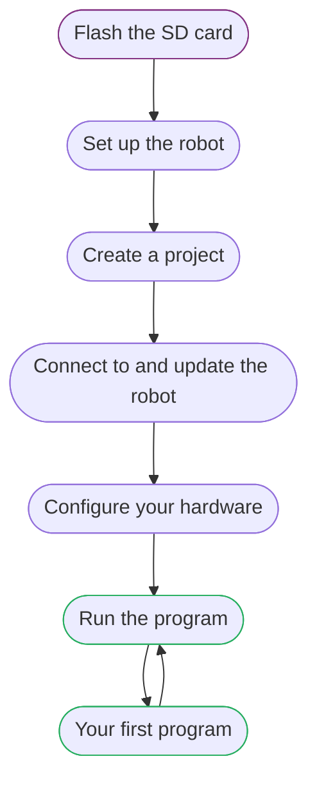

# Getting Started

This section takes you from an empty SD card to a robot that drives. Work through the pages in order; each one ends with a link to the next.

## The zero-to-running-robot journey

The loop at the end is your normal development cycle: write code, run it on the robot, observe, refine. Everything else (flash, connect, update) is one-time setup.

## What you need

- Wombat Controller
- A 8GB SD card with no data on it you wouldn't wanna lose
- Battery pack
- A computer with an internet connection (Windows, Linux or macOS)
- **USB keyboard** — needed once in Step 2 (Set up the robot)
- DC motors wired to motor ports (2 for a differential drivetrain, 4 for mecanum)

## The steps

1. [Flash the SD card](/00-getting-started/01-flash-the-sd-card/)
2. [Set up the robot](/00-getting-started/02-set-up-the-robot/)
3. [Create a project](/00-getting-started/03-create-a-project/)
4. [Connect to and update the robot](/00-getting-started/04-connect-and-update/)
5. [Configure your hardware](/00-getting-started/05-configure-your-hardware/)
6. [Run the program](/00-getting-started/06-run-the-program/)
7. [Your first program](/00-getting-started/07-your-first-program/)

## What comes next

Your robot is running. Here's where to go from here:

| Topic | Where |
|-------|-------|
| Make it drive accurately | [Calibration]() |
| Add sensors, servos, and other hardware | [Robot Definition]() — edit `raccoon.project.yml` |
| Writing real missions | [Missions]() |
| Stop conditions, chaining, timing | [Until Conditions]() |
| Sensors, servos, drive system | [Programming Guide]() |
| Configure sensor positions visually | [WebIDE]() — run with `raccoon web` |
| All CLI commands explained | [raccoon-cli reference]() |
| What you can do from the touchscreen | [BotUI]() |
