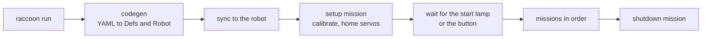

# The Concept of Raccoon

Raccoon is the framework you write your Botball robot program with. This page is the short version of how everything fits together. The next pages go into each part.

## Four ideas

**1. The robot is described in YAML.** Which motors, servos and sensors you have, and on which ports, is written in `raccoon.project.yml` and the files in `config/`. See [Config Structure]().

**2. Python is generated from that YAML.** `raccoon codegen` turns the config into the classes `Defs` (all hardware) and `Robot` (drivetrain, motion settings, mission list). You never edit them. See [Code Generator]().

**3. Your program is a list of missions.** A mission is one self-contained task, for example "drive to the cone and pick it up". A match runs a setup mission, then your missions in the order of `missions.yml`, then a shutdown mission. See [Missions]().

**4. A mission is built from steps.** A step is one action: driving 25 cm, turning 90 degrees, moving a servo to a named position, waiting for a sensor. Steps are combined with `seq([...])` (one after another) and `parallel(...)` (at the same time).

```python
class M010GrabObjectMission(Mission):
    def sequence(self) -> Sequential:
        return seq([
            Defs.claw.open(),
            drive_forward(30),
            Defs.claw.closed(),
            drive_backward(30),
        ])
```

## What a step is

You do not create step classes yourself. You call a function such as `drive_forward(25)`. It returns a builder that you can configure further with chained calls, for example a stop condition:

```python
drive_forward(speed=0.8).until(on_black(Defs.front.right))
```

Builders are steps themselves, so they go directly into `seq([...])`. How the DSL is built, and the `.on_anomaly()` and `.skip_timing()` hooks, are on [Steps DSL](). Every available step with its parameters is in the [Steps Reference]().

## What happens during a run



1. `raccoon run` generates the code on your laptop, copies the project to the robot and starts it there.
2. The **setup mission** prepares the robot: [calibration](), homing the servos.
3. The robot waits for the start signal: the [start lamp]() in a match, the button during development.
4. The **missions** run one after another.
5. The **shutdown mission** runs when all missions are done or the `shutdown_in` timer has expired.

The whole path from a file on your laptop to a moving robot, including the layers of the library, is on [Project Model]() in the Advanced section.
