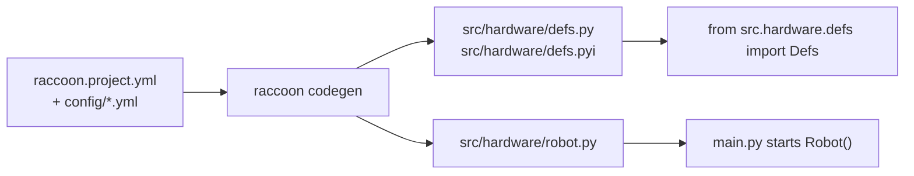

# Code Generator

You describe your hardware in YAML. The **code generator** turns that description into the Python files your missions import, so you never write hardware setup code by hand.



| Generated file | What it contains |
|----------------|------------------|
| `src/hardware/defs.py` | The `Defs` class: one attribute per entry in `config/hardware.yml`, `config/motors.yml` and `config/servos.yml` (`Defs.front`, `Defs.arm`, ...) |
| `src/hardware/defs.pyi` | The type stub for `Defs`, so your IDE completes `Defs.<name>` and knows each type |
| `src/hardware/robot.py` | The `Robot` class: drivetrain, kinematics, odometry and all missions wired together |

These files are **generated, not written**. Never edit them by hand, because the next run overwrites your changes. Change the YAML instead. They are also not committed to git.

---

## When it runs

- **Automatically** on every [`raccoon run`](), locally on your laptop, before the files are synced to the robot.
- **Manually** with `raccoon codegen`, for example to get IDE completion right after you edited the YAML.

Code generation needs no connection to the robot. It runs locally on your laptop.

```bash
raccoon codegen                    # regenerate everything
raccoon codegen --only defs        # only defs.py
raccoon codegen --only robot       # only robot.py
raccoon codegen --no-format        # skip the black formatting step
raccoon codegen -o some/dir        # write somewhere other than src/hardware/
raccoon codegen --no-validate      # skip the validation before generating
```

---

## Validation first

Before generating, raccoon validates the config (the same checks as [`raccoon validate`]()). If the config is inconsistent, codegen stops with an error instead of producing broken code. That includes `Defs.<name>` accesses in your source files that refer to hardware you have not defined.

---

## Typical loop

1. Add a sensor or servo to the YAML, for example in `config/hardware.yml`.
2. Run `raccoon codegen` (or just `raccoon run`).
3. Use it in a mission as `Defs.<name>`.

If a mission fails with a missing attribute on `Defs`, the YAML entry is missing or misspelled. Fix the YAML and generate again.

---

## Related pages

- [Configuration Reference](): every key of every config file.
- [Robot Definition](): how drivetrain, motors, servos and sensors are declared.
- [How Raccoon works](): the path from YAML to a running robot.
- [Arm Kinematics and Code Generation](): the extra code generated for arms.
