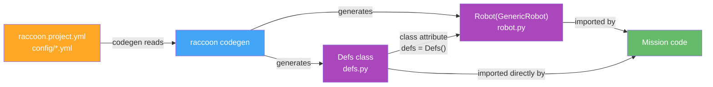
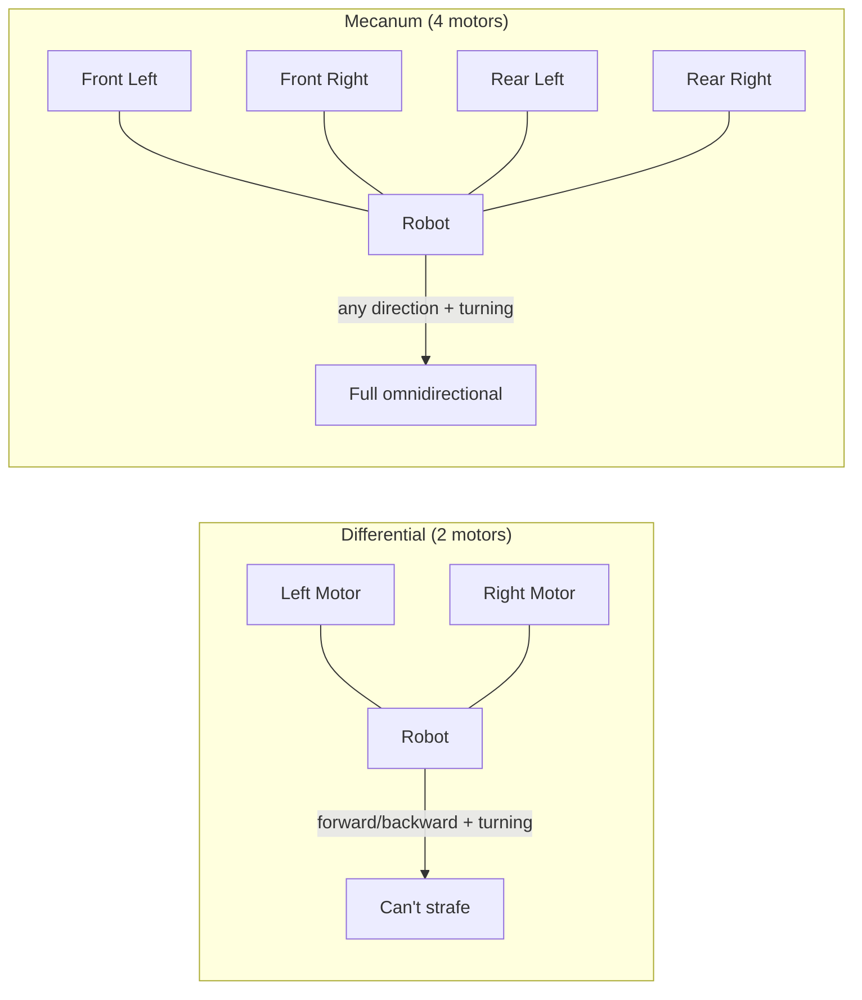

# Robot Definition

## Concept

Before you write a single mission, you need to tell `raccoon` what hardware your robot has and how it's arranged. The robot definition is split between two Python files, both generated from YAML:

- **`defs.py`** (`Defs` class) — the hardware inventory: every motor, servo, and sensor as a class-level Python attribute, resolved to a port
- **`robot.py`** (`Robot` class) — the integration layer: kinematics, drive controller, odometry, physical geometry, and mission list wired together

The relationship looks like this:



All hardware objects in `Defs` are **class-level attributes** (not instance attributes), so mission code can reference `Defs.front_left_motor` without instantiating `Defs`. The `Robot` class does `defs = Defs()`, but reading `Defs.some_sensor` directly from missions is equally correct.

> **Important:** You define hardware in `raccoon.project.yml` and code generation produces `defs.py` and `robot.py` automatically. **Never edit these files by hand** — they are overwritten every time code generation runs. Always make changes in the YAML.

This page explains what the generated code looks like and what each part means, so you understand what to configure in the YAML.

### Readability aliases

Large projects often add an `src/hardware/alias.py` with type-alias assignments to make mission code read more naturally:

```python
# src/hardware/alias.py
from src.hardware.defs import Defs

Servos = Defs   # Servos.claw.closed()
Motors = Defs   # Motors.front_left_motor
Sensor = Defs   # Sensor.front.right
```

All three names point to the same `Defs` class — no subclassing needed. (Pattern from clawbot and packingbot.)

## Hardware Definitions (`defs.py`)

The `Defs` class is a flat list of every physical component on your robot. Each attribute maps to a port on the Wombat controller.

### Motors

```python
from raccoon import Motor, MotorCalibration

front_left_motor = Motor(
    port=0,                    # Wombat motor port (0-3)
    inverted=False,            # True if motor spins backwards
    calibration=MotorCalibration(
        ticks_to_rad=1.947e-05,   # Encoder ticks → radians (set by calibration)
        vel_lpf_alpha=1.0,        # Velocity low-pass filter (1.0 = no filtering)
    ),
)
```

**Parameters:**
- `port`: Physical motor port on the Wombat (0–3)
- `inverted`: Set to `True` if the motor is mounted backwards (spins the wrong way relative to the expected direction)
- `calibration`: Conversion factors measured during [calibration](). You generally don't set these by hand — they're populated by the calibration step

### Servos

Servos can be created plain or with named presets:

```python
from raccoon import Servo, ServoPreset

# Plain servo — you specify angles in your mission code
plain_servo = Servo(port=0)

# Servo with presets — named positions you can call directly
claw = ServoPreset(
    Servo(port=2),
    positions={"closed": 135, "open": 30}
)

# Multi-position servo
arm = ServoPreset(
    Servo(port=1),
    positions={
        "down": 10,
        "above_pom": 55,
        "up": 105,
        "start": 160,
    }
)
```

With `ServoPreset`, you can move to named positions directly in your missions:
```python
Defs.claw.open()       # Moves to angle 30
Defs.arm.above_pom()   # Moves to angle 55
Defs.arm.up(300)       # Moves to angle 105 at 300 degrees/sec (slow servo)
```

### Sensors

```python
from raccoon import IRSensor, DigitalSensor, AnalogSensor, IMU
from raccoon.step.motion import SensorGroup   # SensorGroup is NOT in raccoon top-level

# Inertial measurement unit (one per robot, no port needed)
imu = IMU()

# Infrared line sensors — used for line detection and following
front_right_ir = IRSensor(port=0)
front_left_ir = IRSensor(port=1)

# Digital sensors — buttons, limit switches (returns True/False)
button = DigitalSensor(port=10)
arm_down_limit = DigitalSensor(port=0)

# Analog sensors — raw analog readings
light_sensor = AnalogSensor(port=2)
```

### Sensor Groups

A `SensorGroup` bundles two IR sensors (left and right) and exposes convenience methods for common operations:

```python
front = SensorGroup(left=front_left_ir, right=front_right_ir)
rear = SensorGroup(right=rear_right_ir)  # Single sensor is fine too
```

Sensor groups give you shorthand methods you can call directly in missions:
```python
Defs.front.drive_until_black()          # Drive forward until either sensor sees black
Defs.front.drive_over_line()            # Drive forward over a black line
Defs.front.follow_right_edge(cm=50)     # Follow the right edge of a line for 50 cm
Defs.front.strafe_left_until_black()    # Strafe left until sensor sees black
Defs.front.lineup_on_black()            # Align both sensors on a black line
```

The entries named `button` and `wait_for_light_sensor` have a fixed meaning. Both are described in [hardware.yml]() and [Wait for Light](). `Defs.analog_sensors` lists the analog sensors for the calibration steps.

## Robot Class (`robot.py`)

The `robot.py` file is **entirely code-generated** from the `robot:` section of `raccoon.project.yml`. It wires together your hardware definitions, drive system, kinematics, odometry, motion PID, physical dimensions, and mission list. **Never edit this file by hand** — all configuration goes through the YAML.

Here's what each part of the generated code does and which YAML section it comes from:

### Generated Attributes Reference

| Attribute | What It Does | YAML Source |
|-----------|-------------|-------------|
| `defs` | Hardware definitions instance | `definitions:` |
| `kinematics` | Translates chassis velocity to/from wheel speeds | `robot.drive.kinematics` |
| `drive` | Velocity controller (PID + feedforward per axis) | `robot.drive.vel_config` |
| `odometry` | `@property` — lazily returns platform-managed odometry via `Platform.create_odometry(kinematics)` | Platform-managed; **no YAML key** |
| `motion_pid_config` | Controls trajectory following accuracy (distance/heading PID, axis constraints) | `robot.motion_pid` |
| `shutdown_in` | Emergency stop timer in seconds | `robot.shutdown_in` |
| `setup_mission` | Mission that runs before the start signal | `missions:` (entry tagged `setup`) |
| `missions` | Main missions, run in order after start | `missions:` (untagged entries) |
| `shutdown_mission` | Mission that runs when timer expires | `missions:` (entry tagged `shutdown`) |
| `width_cm`, `length_cm` | Physical robot dimensions | `robot.physical` |
| `rotation_center_forward_cm`, `rotation_center_strafe_cm` | Offset from geometric center to rotation center | `robot.physical.rotation_center` |
| `_sensor_positions` | Where each sensor is mounted relative to rotation center | `robot.physical.sensors` |
| `_wheel_positions` | Where each wheel is mounted (mecanum only) | Derived from kinematics geometry |

### YAML → Generated Code

Here's how the YAML maps to the generated `robot.py`. You configure everything on the left; code generation produces the right:

```yaml
# raccoon.project.yml
robot:
  shutdown_in: 120

  drive:
    kinematics:
      type: differential          # or "mecanum"
      wheel_radius: 0.0345
      wheelbase: 0.16
      left_motor: front_left_motor
      right_motor: front_right_motor

    vel_config:
      vx:
        pid: { kp: 0.0, ki: 0.0, kd: 0.0 }
        ff: { kS: 0.0, kV: 1.0, kA: 0.0 }

  # NOTE: Do NOT add an "odometry:" key here.
  # Odometry is now platform-managed. The codegen emits an @property
  # that calls Platform.create_odometry(kinematics) at runtime.
  # If you add "odometry:" the codegen logs a warning and ignores it.

  motion_pid:
    distance: { kp: 7.875, ki: 0.0, kd: 0.0 }
    heading: { kp: 7.875, ki: 0.0, kd: 0.0625 }
    linear:
      max_velocity: 0.2368
      acceleration: 0.2798
      deceleration: 2.0532
    angular:
      max_velocity: 2.9424
      acceleration: 14.6122
      deceleration: 7156.1491

  physical:
    width_cm: 13.0
    length_cm: 19.0
    rotation_center:
      x_cm: 2.5
      y_cm: 5.5
    sensors:
      - name: front_right_ir_sensor
        x_cm: 14.0
        y_cm: 7.5
        clearance_cm: 1.0

missions:
  - M000SetupMission: setup
  - M010DriveToConeMission
  - M999ShutdownMission: shutdown
```

All the PID values, axis constraints, kinematics parameters, and physical dimensions are set in the YAML. Code generation turns them into the Python `Robot` class. Auto-tune and calibration steps update these YAML values automatically.

### Real mecanum config with `start_pose` and sensor positions

Here is a complete mecanum `config/robot.yml` from a real competition robot (adapted from clawbot). It shows all the fields you need for a mecanum build — including `start_pose`, which sets the initial localization estimate when the robot starts:

```yaml
# config/robot.yml
shutdown_in: 120
drive:
  kinematics:
    type: mecanum
    wheel_radius: 0.0375
    track_width: 0.2
    wheelbase: 0.125
    front_left_motor: front_left_motor
    front_right_motor: front_right_motor
    back_left_motor: rear_left_motor
    back_right_motor: rear_right_motor
  vel_config:
    vx:
      pid: { kp: 0.001438, ki: 0.86309, kd: 0.000157 }
      ff:  { kS: 0.0, kV: 1.0, kA: 0.0 }
    vy:
      pid: { kp: 0.0, ki: 0.0, kd: 0.0 }
      ff:  { kS: 0.0, kV: 1.0, kA: 0.0 }
    wz:
      pid: { kp: 0.0, ki: 0.0, kd: 0.0 }
      ff:  { kS: 0.0, kV: 1.0, kA: 0.0 }

  # NOTE: Do NOT add an "odometry:" key — odometry is platform-managed.

motion_pid:
  distance: { kp: 5.1566, ki: 0.0, kd: 0.2592 }
  heading:  { kp: 5.1566, ki: 0.0, kd: 0.2592 }
  linear:
    max_velocity: 0.2139
    acceleration: 0.9402
    deceleration: 1.6644
  lateral:
    max_velocity: 0.2209
    acceleration: 0.6485
    deceleration: 0.4498
  angular:
    max_velocity: 1.7687
    acceleration: 6.9769
    deceleration: 20

physical:
  width_cm: 23.5
  length_cm: 26
  table_map: config/2026-game-table.ftmap
  rotation_center:
    x_cm: 11.75
    y_cm: 13.0
  sensors:
    - name: rear_left_light_sensor
      x_cm: 1.0
      y_cm: 1.8
      clearance_cm: 0.0
    - name: front_right_light_sensor
      x_cm: 22.5
      y_cm: 24.7
      clearance_cm: 0.0
  start_pose:
    x_cm: 156.31
    y_cm: 75.78
    theta_deg: 0.31
```

**`start_pose`** sets the initial localization estimate (position + heading) when the robot starts. Without it, localization begins at the origin `(0, 0, 0°)`. For competition robots that start in a known position on the table, this prevents an initial position jump in the localization trace. Coordinates use the same frame as the `.ftmap` table map.

### Kinematics: Differential vs. Mecanum



| Feature | Differential | Mecanum |
|---------|-------------|---------|
| Motors | 2 | 4 |
| Can drive forward/backward | Yes | Yes |
| Can turn in place | Yes | Yes |
| Can strafe sideways | No | Yes |

In competition, you typically use both: one differential and one mecanum robot. Set `type: differential` or `type: mecanum` in the YAML kinematics section accordingly.

## Related

- [Code Generator](): how the YAML becomes these classes
- [Missions](): the setup, main and shutdown missions the `Robot` class runs, the `shutdown_in` timer and the per-mission time budget
- [hardware.yml](): the required `button` entry and `Defs.analog_sensors`
- [Project Model](): the full relationship between YAML, codegen and runtime
