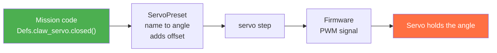

# Servos in servos.yml

A servo is a position-controlled actuator: you give it an angle in degrees and the servo holds that angle. The feedback loop is inside the servo, raccoon only sends the target angle.

Servos are declared in `config/servos.yml`. [`hardware.yml`]() merges that file in, so every servo becomes an attribute on `Defs`.

## Entry

| Key | Type | Default | Description |
|-----|------|---------|-------------|
| `type` | `string` | | Must be `Servo`. |
| `port` | `integer` | | **Required.** Servo port number (0 to 5 on the Wombat). |
| `positions` | `mapping` | | Optional. Position name to angle in degrees, see [Servo Positions](). |
| `offset` | `float` | `0` | Degrees added to every position, see [Offsets and Calibration](). Only used together with `positions`. |

A servo without `positions` is a plain `Servo`: you pass the angle in your mission code, see [Servo Steps]().

```yaml
# config/servos.yml
arm_servo:
  type: Servo
  port: 0
  offset: 0
  positions:
    up: 30
    down: 160

claw_servo:
  type: Servo
  port: 1
  positions:
    open: 30
    closed: 135

lamp_servo:        # plain servo, no positions
  type: Servo
  port: 2
```

## What the codegen makes of it

A servo with `positions` is wrapped in a `ServoPreset`. The `port` is the only argument that reaches the `Servo`, `positions` and `offset` belong to the wrapper.

```python
class Defs:
    arm_servo = ServoPreset(Servo(0), positions={'up': 30, 'down': 160}, offset=0)
    claw_servo = ServoPreset(Servo(1), positions={'open': 30, 'closed': 135})
    lamp_servo = Servo(2)
```



All angle arithmetic happens when the step is built. The firmware only receives the final angle.
