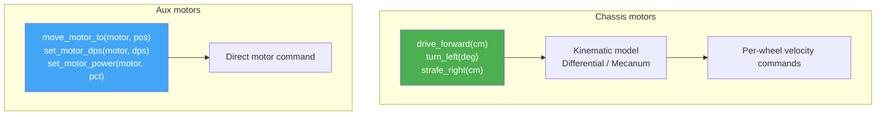

# Motors

Raccoon has two kinds of motors, and they are controlled in completely different ways.

| | Chassis motors | Aux motors |
|-|----------------|------------|
| What | The drivetrain wheels (front-left, front-right and so on) | Everything else: arm lifts, drum collectors, conveyors, indexers |
| Controlled by | The kinematic model (`DifferentialKinematics` or `MecanumKinematics`), through `drive_forward`, `turn_left`, `strafe_right` and the other [driving steps]() | Directly, one motor at a time, with the motor steps |
| Named in | `drive.kinematics` of `robot.yml` | Only in `motors.yml` |

**Never command a chassis motor directly.** Do not use `move_motor_to`, `set_motor_power`, `set_motor_dps` or the other motor steps on a drivetrain motor: you fight the drive controller and the robot drives unpredictably. In the other direction, aux motors are not part of the kinematic model, so `drive_forward` does not move them.

| Page | What it covers |
|------|----------------|
| [Motor config]() | Declaring a motor in `motors.yml` |
| [Move to Position]() | `move_motor_to` and `move_motor_relative` |
| [Other Motor Steps]() | Velocity, power and stop steps, stop modes, patterns |
