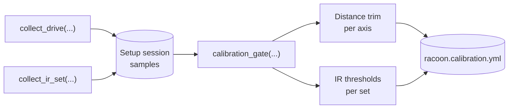

# Calibration

Every motor and sensor is a little different, and so is every table. Calibration measures those differences once, during the setup mission, so that `drive_forward(50)` drives 50 cm and the IR sensors know what black looks like on your table.

You calibrate in the setup mission with three kinds of steps:

1. **Collectors** wrap a motion you drive anyway and record evidence while it runs: [`collect_drive`]() for distance, [`collect_ir_set`]() for IR sensors.
2. **The gate**, [`calibration_gate`](), turns that evidence into stored values once, after all collectors have run.
3. **Everything else** is in [Other Calibration](): `--no-calibrate`, motor calibration commands, single-sensor steps.



## A typical setup mission

This is the calibration part of the template's `M000SetupMission`. The robot drives 50 cm forward. While it does, the front IR sensors are sampled and the driven distance is recorded. The gate then applies both.

```python
from raccoon import *
from src.hardware.defs import Defs

class M000SetupMission(SetupMission):
    calibration_distance_cm = 50

    def sequence(self) -> Sequential:
        return seq([
            run_unless_no_calibrate(
                seq([
                    wait_for_button("Place the robot with 50 cm of room in front of it."),

                    # Heading 0 for the calibration drive and later turn_to_heading_* steps
                    mark_heading_reference(),

                    collect_drive(
                        collect_ir_set(
                            drive_forward(self.calibration_distance_cm),
                            set_name="default",
                            sensors=[Defs.front_left_ir_sensor, Defs.front_right_ir_sensor],
                        ),
                    ),

                    calibration_gate(
                        require_axes=[CalibrationAxis.FORWARD],
                        require_ir_sets=["default"],
                    ),
                ]),
            ),
        ])
```

If the robot has no IR sensors, drop `collect_ir_set` and `require_ir_sets`. During the drive, every IR sensor must pass over at least one black line, otherwise the thresholds cannot be computed.

## Where the values are stored

| Value | Stored in |
|-------|-----------|
| Distance scale per axis (`forward`, `lateral`) | `racoon.calibration.yml`, section `motion-trim` |
| IR thresholds per sensor and set | `racoon.calibration.yml`, key `<set>_port<N>` |
| Analog sensor reference values | `racoon.calibration.yml`, section `analog-sensor` |
| Motor values (`ticks_to_rad`, autotune results) | `config/motors.yml`, written by the [calibration commands]() |

Stored values are loaded automatically when the robot starts, so you can skip calibration with [`--no-calibrate`](#skipping-calibration).

| Page | What it covers |
|------|----------------|
| [Collect Drive]() | Recording a distance sample while driving |
| [Collect Strafe]() | The same for sideways driving on mecanum robots |
| [Collect IR]() | Recording IR samples, how thresholds are computed, calibration sets |
| [Calibration Gate]() | Applying the collected evidence |
| [Other Calibration]() | `--no-calibrate`, motor commands, single-sensor steps |
