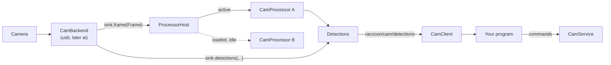

# Concept

Your mission code asks for results; it never opens the camera itself. A separate service owns the device and the OpenCV code, so restarting your program does not close the camera and does not throw away a loaded model or a calibration.

## Concept: backend, processor, host

Three roles share the work.

- A **backend** is the source. It opens a device and pushes data into the service whenever it has some.
- A **CamProcessor** is a function from one image to a list of detections. It knows nothing about the camera.
- The **ProcessorHost** holds the loaded processors, runs the active one on every frame and keeps a failing processor from taking the service down.



The `CamService` is the process around backend and host. [The Service]() describes it and the client.

A backend that already produces results, such as a camera that runs a model on the device, pushes them straight into the output. A backend that only delivers images feeds the processors.

## Concept: loaded processors and the active one

Loading a processor is the slow part: the service imports its module (OpenCV, a model runtime) and calls `configure`. Running it on a frame is cheap by comparison. So the work is split in two steps that you do at different times.

| Step | Call | What happens |
|---|---|---|
| Load | `load_processor(...)` | The processor goes into a pool and the service imports and configures it right away. The camera stays closed |
| Choose | `set_processor(name)` | One loaded processor is the active one. Only it runs on the frames |
| Swap | `change_processor(name)` | Makes another loaded processor the active one while the camera runs. Nothing is loaded for it, so it is quick |

Everything you want to switch between is loaded before `start_camera()`. A swap in a running camera then costs a name lookup, and the processor you leave keeps its state. A swap to a processor that was never loaded is an error and changes nothing. [Processors](#load-set-and-change) has the details, and a wrong setup is refused while the program runs through its declarations, see [Checking the setup](#checking-the-setup).

## Concept: the backend decides what arrives

The service does not poll a backend. The backend calls the sink when it has something, from any thread and at any rate. This matters for cameras whose behaviour you do not know in advance: whether they give you images, results or both, and when, is the backend's business.

Each backend declares two flags, and both are required:

| Flag | Meaning |
|---|---|
| `allow_processors` | The backend delivers images, so CamProcessors can run on them |
| `provides_detections` | The backend delivers ready-made detections |

A backend that leaves a flag unset is rejected when you select it, so a forgotten flag fails early instead of acting like `False`.

## Concept: why processing is not in your program

Processing runs in the service because of three problems you get otherwise.

1. Your program restarts often during development and between runs. Anything it holds (buffers, calibration, a loaded model) is lost each time.
2. Moving full frames from the service to your program costs copies and memory on a Raspberry Pi, and only the small detection results need to cross.
3. Image processing in your program competes with the mission code for the interpreter.

The cost is that a processor you write runs inside the service, not in your program. See [Processors](#where-your-class-runs) for what that means for your code.

## Data types

Two plain types move through the system. They are kept simple on purpose, so a processor written in another language can follow the same contract later.

```python
Frame(image: np.ndarray, timestamp: float, seq: int = 0)
```

`image` is BGR, `uint8`, shape `(height, width, 3)`. `timestamp` is `time.monotonic()` at capture. `seq` increases by one for each frame from the backend.

```python
Detection(label, x=0, y=0, w=0, h=0, confidence=1.0, area=0.0, extra={}, source="")
```

`x` and `y` are the centre of the box, and `w` and `h` its size, all normalised to 0..1 relative to the frame. `area` is in pixels. The host fills `source` with the name of the processor that produced the detection when the processor leaves it empty.

`extra` holds additional numbers or strings for code inside the service. It does not travel to your program, because the message type `cam_blob_t` has no field for it.
