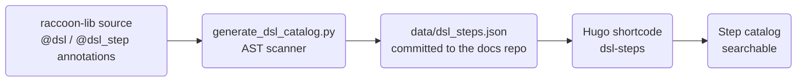

# Steps Reference

The complete catalog of public steps, generated from the `raccoon-lib` source on every release. Use the search box and the tag filters to find a step, and click a card for its full signature, arguments and documentation.

All steps are re-exported from the top-level package, so one import is enough in a mission file:

```python
from raccoon import *
```

New to steps? The [Programming Guide]() explains how to use them. This page is where you look up the exact parameters.

---

## Step catalog




## Python and C++ API

Beyond steps, the full Python API (motors, servos, sensors, missions, calibration and more) and the native C++ reference are published with each release:

- <a href="/api/autoapi/index.html" class="api-link" target="_blank">Open Python API Reference</a>
- <a href="/api/doxygen/index.html" class="api-link" target="_blank">Open C++ API Reference</a>

## Where the catalog comes from

The step catalog is not written by hand. Every public step in `raccoon-lib` is annotated with `@dsl` or `@dsl_step`, which registers it with a name, a signature and its documentation. On every library release a scanner (`docs/generate_dsl_catalog.py` in `raccoon-lib`) reads these annotations and writes them to `data/dsl_steps.json`. The Hugo shortcode `dsl-steps` renders that file.



The catalog is a snapshot of the latest release. If your robot runs an older `raccoon-lib`, some steps may not exist yet. Use `raccoon update` to stay current.
