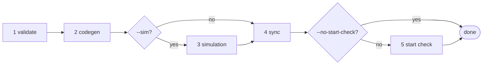

# raccoon upload

```bash
raccoon upload
raccoon upload --sim
raccoon upload --no-start-check
```

`raccoon upload` is the "will this actually run on the field?" command. It chains validation, code generation, an optional simulation, the sync to the robot and a start check into one run. Every step that runs is a hard gate: the first failure stops the command before anything reaches the robot.

## The five steps



| Step | What happens |
|------|--------------|
| 1. Validate | The same checks as [`raccoon validate`]() (code generation is checked in step 2) |
| 2. Codegen | Regenerates the files in `src/hardware/` from `raccoon.project.yml` |
| 3. Simulation | Only with `--sim`. Runs the whole project once in the libstp simulator. It must exit with code 0 and without a simulator error |
| 4. Sync | Pushes the project to the connected Pi, like [`raccoon sync`]() |
| 5. Start check | Starts the program on the robot, waits until it is running or has finished cleanly, then stops it again |

> **Safety:** the start check really starts your program on the robot. The motors can move for a moment. Put the robot where it can do that safely.

## Options

| Option | Default | Description |
|--------|---------|-------------|
| `--sim` | off | Run the simulation (step 3). Without it, step 3 is skipped |
| `--sim-timeout SECONDS` | `180` | Timeout for the simulation run |
| `--no-start-check` | off | Skip step 5. The program is not started on the robot |
| `--start-timeout SECONDS` | `8` | How long to wait for the program to come up on the robot |
| `--no-python-compile` | off | Skip the Python compile check inside the validation |

## What counts as a failed start

The start check fails if the program ends with status `failed` or with an exit code other than 0 within the timeout. It succeeds if the program is running, has finished cleanly, or is still running when `--start-timeout` expires. The last output lines of a failed start are printed.

## Requirements

- You must be inside a project (a folder with `raccoon.project.yml` that has a `uuid`).
- The robot must be reachable, see [connect]().

## upload or run?

`upload` only brings the project onto the robot and proves that it starts. It does not run your missions to the end. To actually drive, use [`raccoon run`]().
