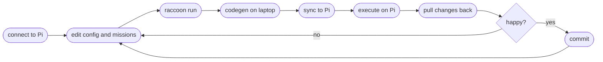

# Raccoon CLI

`raccoon` is the command line tool you use on your laptop. It connects to the robot, generates code from your config, syncs your files and runs your missions on the Pi. Install it with `uv sync` inside a project; see [Create Your Project](). It needs Python 3.13 or newer.

Projects are created with the setup script of the example project, not with the CLI. After that you use `raccoon` from inside the project.

## The developer loop



Code generation and all validation happen on your laptop. The Pi only receives the final Python files, which keeps the loop fast even over a slow WiFi link.

## Commands at a glance

| Command | What it does | Page |
|---------|--------------|------|
| `raccoon connect <ip>` | Link to the robot and set up SSH keys | [connect]() |
| `raccoon disconnect` | Drop the active connection | [disconnect]() |
| `raccoon shell` | Open an SSH shell on the Pi | [shell]() |
| `raccoon run` | Checkpoint, generate code, sync, execute, pull back | [run]() |
| `raccoon sync` | Push or pull files between laptop and robot | [sync]() |
| `raccoon codegen` | Generate `defs.py`, `defs.pyi` and `robot.py` | [codegen]() |
| `raccoon mission` | Create, list, rename, remove and reorder missions | [missions]() |
| `raccoon calibrate` | Ticks, autotune, servos and step response | [calibrate]() |
| `raccoon logs` | Show, tail, download and clear robot logs | [logs]() |
| `raccoon checkpoint` | Automatic safety snapshots of your project | [checkpoint]() |
| `raccoon validate` | Check config, missions and imports | [validate]() |
| `raccoon format` | Format the code in `src/` with Black | [format]() |
| `raccoon doctor` | Health check of tools, connection and versions | [doctor]() |
| `raccoon update` | Bring laptop and robot to the same bundle | [update]() |
| `raccoon migrate` | Apply project format migrations | [migrate]() |
| `raccoon upload` | Full preflight, then push to the robot and confirm it starts | [upload]() |
| `raccoon web` | Start the WebIDE | [web]() |

All commands support `-h` / `--help`. Run `raccoon <command> --help` for the complete list of options of any command.

## Auto-validation

Before `raccoon run`, raccoon runs `raccoon validate` against your project to catch config errors before anything is synced or executed. Other commands do not validate on their own. Run [`raccoon validate`]() yourself, or use [`raccoon upload`](), which validates as its first step.

To skip it for one call, use the global flag:

```bash
raccoon run --no-validate
```

## Reading order

New to the CLI? Read in this order:

1. [connect](): SSH key setup and saved connections
2. [run](): the command you use all day
3. [Run Configurations](): parameterize `dev` versus `competition` runs
4. [sync](): what happens under the hood
5. [checkpoint](): the safety net before every run

For maintenance and problems, jump to [update](), [migrate](), [Troubleshooting and Recovery](), [doctor]() and [raccoon-server]() (the daemon on the Pi).

The transport contract check that `connect` and `doctor` report is explained in [Advanced → Transport]().
