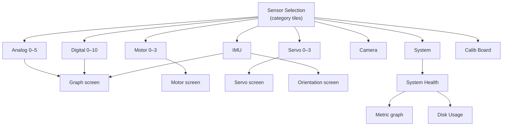

# Sensors & Actors

Sensors & Actors is the diagnostic and manual-control hub of BotUI. Use it to check that a sensor works, to see what a value really looks like over time, to spin a motor or move a servo by hand, and to look at the health of the Pi. Everything on these screens is live.

## How the Data Gets Here

BotUI subscribes to the sensor channels on the [transport]() and pushes the values into Riverpod providers, so the widgets rebuild by themselves. Nothing is requested on demand: whatever `stm32-data-reader` publishes is what you see. Commands (motor power, servo angle, …) go the other way over the same transport.

Every screen follows the same drill-down: pick a category, pick a port, arrive at a screen for that kind of sensor. The back arrow goes up one level.

## Sensor Selection

The first screen is a grid of category tiles. The tile for a category with exactly one sensor (Camera, System, Heading) opens that sensor directly, without a list in between.

| Tile | What it opens |
|------|---------------|
| **Analog** | Ports 0–5, each a graph (0–4095) |
| **Digital** | Ports 0–10 as indicator tiles |
| **Motor** | Ports 0–3, each a motor screen |
| **Servo** | Ports 0–3, each a servo screen |
| **IMU** | Gyro, Accel, Magneto, Orientation, Heading |
| **Camera** | The camera menu: backend settings and the live picture |
| **System** | CPU, RAM, disk, temperatures, battery, uptime |
| **Calib Board** | [Calibration Board](); always shown, grey while no board is connected |

### IMU

All IMU measurements are behind one **IMU** tile. Inside, each measurement is a tile (Gyro, Accel and Magneto have a graph per axis X/Y/Z). The top bar of the IMU screens shows the IMU die temperature and the accuracy of the sensor fusion for the measurement you are looking at (gyro, accel, magneto or orientation).

### Digital Ports

Digital ports are shown as a grid of two rows. Ports 0–4 are on the top row, ports 5–9 on the bottom row, and port 10 stands alone in the right column, labelled **Built-In Button**. A tile shows its state live: a filled circle means the port is pressed / HIGH, an empty circle means LOW. Tap a tile to open the graph of that port.

## Graph Screens

Analog, digital and IMU axes open a scrolling time series: newest value on the right, the graph moves left.

| Sensor | Range of the Y axis |
|--------|--------------------|
| Analog | 0 – 4095 (raw ADC) |
| Digital | 0 – 1 |
| Gyro X / Y / Z | −180 – 180 |
| Accel X / Y / Z | −10 – 10 |
| Magneto X / Y / Z | −256 – 256 |
| Heading | 0 – 360 |

- The graph is sampled every 20 ms and keeps the last **250 samples** (5 s) by default. A thin second line is a moving average over the last 10 samples.
- The **pause** button in the top bar freezes the graph so you can read it. Press it again to continue.
- The blue button next to it switches between **Fixed** (the range from the table above) and **Auto Scale** (fits the graph to the visible data). Use Auto Scale for small changes, for example a gyro at rest.
- The strip below the graph shows the **current** value and the **average**. Tap it to expand: **Min**, **Max**, **Median**, **Std** (standard deviation), a distribution chart of the visible samples, and a **Samples** slider (50 to 1000) that sets how long the graph history is.

## Orientation

**IMU → Orientation** shows the orientation from the quaternion of the IMU as three live curves: **Roll** (red), **Pitch** (green) and **Yaw** (blue), with their current values in degrees above the plot. The top bar shows the IMU temperature and accuracy.

Use it to check that the IMU is mounted the way you think, or that the filter has settled after a reboot. For the calibration board's own IMU there is a [separate screen]() with an artificial horizon.

## System Health {#system-health}

The **System** tile opens seven cards in two columns. Colored cards show the severity at a glance.

| Card | Shows | Green | Orange | Red |
|------|-------|-------|--------|-----|
| **CPU** | Load in % | up to 60 % | 60–85 % | over 85 % |
| **RAM** | Used / total MB | up to 60 % | 60–85 % | over 85 % |
| **Disk** | Used / total GB | up to 60 % | 60–85 % | over 85 % |
| **CPU Temp** | SoC temperature | up to 50 °C | 50–70 °C | over 70 °C |
| **IMU Temp** | IMU temperature | up to 50 °C | 50–70 °C | over 70 °C |
| **Battery** | Voltage, two decimals | always green | | |
| **Uptime** | Time since boot, e.g. `3h 12m` | grey | | |

Tap a card for more: **CPU**, **RAM** and **Battery** open a graph of that value (same controls as the sensor graphs), **CPU Temp** and **IMU Temp** open one temperature graph with both curves, and **Disk** opens **Disk Usage**. Uptime has no detail screen.

**Disk Usage** scans the directories on the SD card (this takes a moment, a message tells you so) and shows a chart of where the space is used, and how much is free. Look here first if the robot reports a full disk.

## Camera

The **Camera** tile opens the camera menu. At the top are two buttons, **Configure backend** and **Configure processor**. Below is the live picture from `raccoon-cam`, with the detections of the processor drawn on top. The menu holds the camera open while you are in it and gives it back when you leave, so a robot program that uses the camera at the same time keeps working. If no backend has been chosen yet, the picture area says so.

**Configure backend** opens a screen with a dropdown on top. It lists the built-in backends (`Built-In · usb`) and the backends in your projects (`Project (<name>) · <backend>`). Choosing one shows a form with a field for each option the backend declares (numbers, text, switches, choices, an image size); defaults are filled in, and an option's description is the hint of its field. **Save** checks the values with the backend and keeps them on the robot for every program; a wrong value is reported in a message with the reason. **Reset** removes the choice. The values you typed for a built-in backend are remembered on the robot automatically, so they are still there when you switch to another backend and back; **Reset** forgets them. A program can still pick its own backend with `set_backend`, which overrides this only while it runs. How to make your own backend appear in the dropdown is described in [Backends]().

**Configure processor** is the same screen for the processor that runs on the frames while the UI uses the camera: the live picture here and the camera picture in a program's UI screen. The dropdown lists the built-in processors (`Built-In · ColorBlobs`) and the processors that the projects on the robot define (`Project (<name>) · <processor>`); the projects are scanned for classes that inherit `CamProcessor`. Choosing one shows a form with a field for each of its options. A list of names that the processor offers, like the colours of `ColorBlobs`, is a row of buttons to switch on and off; other structured options are a field for JSON. **Save** checks the values with the processor and keeps them on the robot, **Reset** removes the choice. The camera applies a change at once, without a restart. The processor runs while the UI holds the camera open. A program that loads processors of its own takes its place for as long as it runs. See [Processors]().

The camera is otherwise configured with the [camera client API]() and `raccoon-cam.service` is managed under [Settings → Services]().

## Motor Screen

A motor port opens a screen with a **mode sidebar** on the left and the control on the right.

| Mode | Control |
|------|---------|
| **POWER** | Circular slider from −100 to +100 (PWM duty in percent) |
| **VEL** | Circular slider from −1500 to +1500 (encoder ticks per second, closed loop) |
| **POS** | Number pad for a target position in encoder ticks, with a velocity selector |
| **GRAPH** | Live plot of back-EMF or position |

**Sliders.** Drag the handle clockwise to increase the value. While the handle moves, the command is sent at most about 30 times per second.

**Position.** Type the target on the number pad (up to 7 digits), flip the sign with `+/−`, set the approach velocity with the arrows (steps of 100, from 0 to 5000), and tap **Go**. The **Relative** switch decides whether the number is an absolute target or a distance from the current position.

**Graph.** A toggle switches between **BEMF** and **position**, sampled at 10 Hz (the last 250 samples). In velocity mode the target velocity is drawn as a reference line on the BEMF graph.

**Status bar.** Below the control, the screen always shows the current **BEMF** and **POS** (encoder position) and a **DONE** chip that lights up when a move-to-position has finished (hidden in graph mode).

### Stop Buttons

Four buttons are always visible at the bottom, whatever the mode:

| Button | What it does |
|--------|--------------|
| **BRAKE** (red) | Passive brake: shorts the motor windings. The motor resists turning without using current, but can still creep. |
| **HOLD** (orange) | Active brake: commands a velocity of 0 and lets the PID loop hold it. This uses current. |
| **OFF** (grey) | Coast: no current, the motor spins freely. |
| **Reset POS** (dark grey) | Sets the encoder counter to 0. |

The motor list also has a full-width **Stop All Motors** button that sets the power of all four motors to 0.

## Servo Screen

A servo port opens a screen with a **type sidebar** on the left and the control on the right. The sidebar selects what is plugged into the port:

| Type | Servo | Control |
|------|-------|---------|
| **PWM** | Classic hobby servo | Arc slider, 0° to 180° |
| **BUS** | Feetech STS serial bus servo (e.g. STS3215) | Full-turn position ring, speed, spin and health |

The sidebar is always switchable. Until you pick a type it follows the mode the port is in. Picking **BUS** puts the port into bus mode (the servo starts relaxed, torque off); picking **PWM** leaves bus mode with the PWM output still off, and the first move of the slider switches it on.

### PWM Servo

A large arc slider with a readout of the commanded angle (`CMD`), the angle reported by the servo (`ACT`), and the current servo mode.

- **Normal range:** 0° to 180°. Moving the handle sends the new position.
- **Danger mode:** the **Danger** button widens the range to −50° … 360°. Angles outside 0–180° can damage the servo or your mechanism, so use it only when you know the hardware allows it. Turning Danger off again clamps the angle back to 0–180°.
- **Fully Disable** cuts the power to the servo; it goes limp and the angle reads 0° again.

The servo list has a **Disable All Servos** button that does this for all four ports.

### Bus Servo

A bus servo reports its own position, so unlike a PWM servo the screen shows what the servo really does. One servo per port; the robot finds it by itself, you do not have to set an ID. While no servo answers, the controls are greyed out and the status card says either `Waiting for the bus servo on port N...` or `No bus servo answers on port N. Check cable and battery.`

**Position ring.** Drag the handle to move the servo to an angle from 0° to 360°. The middle of the ring shows the **target** (`Target`) and the measured angle (`ACT`). The servo counts past 360°, so below `ACT` a `turn +2` or `turn -1` shows how many full turns it is away from where it connected. A chip shows the state of the last move:

| Chip | Meaning |
|------|---------|
| **Moving** | The servo is on its way |
| **In position** | The target is reached |
| **Blocked** | The servo stopped before the target (something is in the way, or it is overloaded) |

While you drag, the target is sent about 20 times per second; the ring follows the measured angle again once you let go.

**Move speed.** **MAX** moves at the full speed of the servo. **180°/s**, **90°/s** and **30°/s** run the move at that speed with a short ramp at start and end.

**Spin.** The slider from −360 to +360°/s (steps of 30) makes the servo turn continuously; the speed is sent when you let go. **HOLD** stops the spinning and holds the angle the servo is at.

**Relax (torque off).** Releases the servo so you can turn it by hand. The position is still reported. Any new command makes it hold again.

**Status card.** Shows the supply voltage, temperature, speed and the load in percent of the maximum torque (a bar, orange above 80 %). The voltage turns orange below 5.0 V and the temperature from 60 °C. If the servo reports an error, a red chip names it:

| Chip | Cause |
|------|-------|
| **Voltage** | Supply voltage outside the allowed range |
| **Sensor** | Position sensor error |
| **Overheat** | The servo is too hot |
| **Current** | Too much current |
| **Angle** | Angle error |
| **Overload** | The load is too high for the servo |

For driving a bus servo from your own tools, see [the bus servo channels]().

### Shutdown Guard

When the firmware has the motors latched off (after a watchdog trip or a user-initiated shutdown, see [System Popups]()), opening a motor port first asks:

> **Motors Disabled** — Shutdown flags are enabled. Motors cannot be controlled until shutdown is disabled.

**Disable** clears the shutdown flag and continues to the screen, **Cancel** goes back. Without this guard, commands would be acknowledged but nothing would move.
