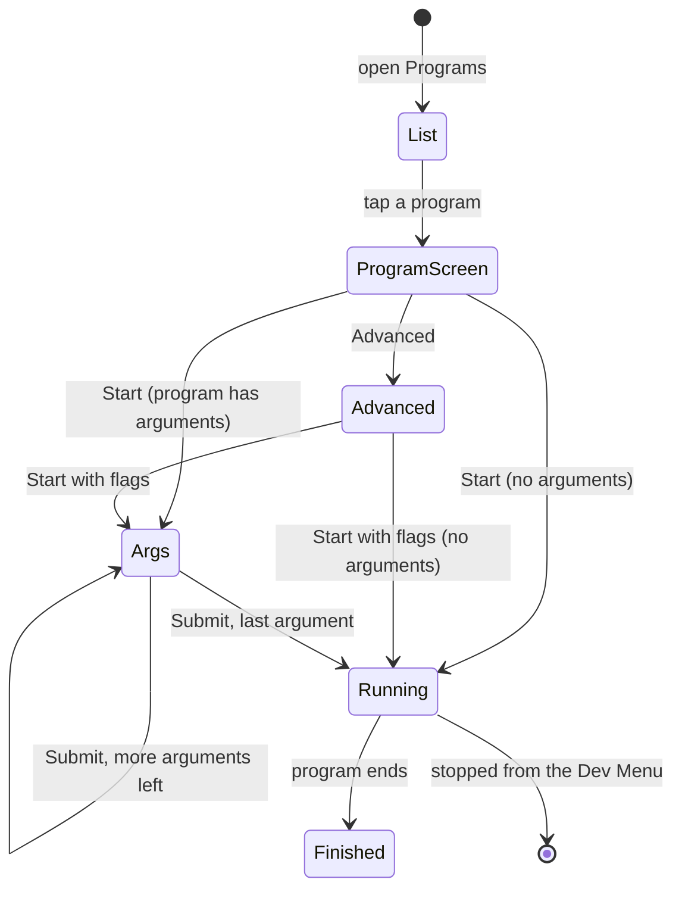

# Programs

The Programs screen lists every program on the robot. Tap one to see its sync state, start it, and watch its output. This is how you run a program on the day of the competition, without a laptop.


## Concept

BotUI does not run your Python code itself. When you press **Start**, it asks the `raccoon-server` on the robot to run the project, exactly like `raccoon run` does from your laptop. The server runs the project and streams the output back over a WebSocket, and BotUI shows it in a terminal. That is why a program that was started from your laptop can also be stopped from the robot, and the other way around.

What BotUI adds on top is **visibility**: the version chip on every program shows whether and when the code was pushed with `raccoon sync`. The most important competition-day check is: *is this the code I think it is?*



## The Program List

The list is a grid with one tile per project in the robot's `programs` directory (`/home/pi/programs`). Each project is one subdirectory, and `raccoon sync` puts them there. If the directory is empty the screen says **No programs**.

Each tile shows the program name and a **version label**:

- **`v3`**: the program was pushed with `raccoon sync`, and the number counts the successful pushes.
- **`NOT SYNCED`** (red): the robot has no sync record for this project, so the files may be placed by hand or old.

The list watches the directory. When `raccoon sync` writes files, the list updates by itself a moment after the last change, without flickering, so you can watch a new version arrive.

### Where the Name and Arguments Come From

For each project directory, BotUI reads the descriptor files in this order:

1. **`raccoon.project.yml`**: the `name` field is the program name. This file defines no arguments.
2. **`project.json`**: used when there is no (readable) `raccoon.project.yml`. It can set `name` and a list of launch `args`.
3. If neither file helps, the **directory name** is the program name.

```yaml
# raccoon.project.yml
name: "Autonomous Mission A"
```

```json
// project.json: name and typed arguments
{
  "name": "Autonomous Mission A",
  "args": [
    { "type": "bool",   "name": "skip_intro", "initial": false },
    { "type": "number", "name": "speed", "initial": 50, "min": 0, "max": 100, "step": 5 }
  ]
}
```

| Argument type | Fields | Input on the robot |
|---------------|--------|--------------------|
| `bool` | `name`, `initial` (default `false`) | Large checkbox |
| `number` | `name`, `initial` (0), `min` (0), `max` (100), `step` (1) | Counter with plus and minus |

## The Program Screen

Tapping a tile opens the screen of that program. The top bar shows the program name and the version chip. Before a run it shows two large tiles, **Start** and **Advanced**, and the **sync details** card below them.

### Sync Details

The card shows what the robot knows about the last push. For a synced program:

| Row | Meaning |
|-----|---------|
| **Version** | The push counter (also in the chip) |
| **Last update** | When the push happened, for example `just now` or `3 hours ago` |
| **Updated by** | Who pushed, for example `tobias@laptop` |
| **Fingerprint** | The start of the SHA-256 hash of the project files |

For a project that was never pushed, the card says that the files on the robot may be stale or edited by hand.

BotUI reads this from `<project>/.raccoon/sync_state.json`, which `raccoon sync` writes. BotUI never changes it.

### Start

**Start** begins the run. If the program declares arguments, one full-screen question per argument appears first. Set the value and tap **Submit** to go to the next one. After the last answer the program starts.

The arguments are handed to the program as `--name=value`, for example `--skip_intro=false --speed=50.0`.

If the start fails (no API token, the server is not running, the server refuses), a red message **Start failed: …** appears at the bottom for a few seconds and nothing starts.

### Advanced

**Advanced** opens two switches. Set them, then tap **Start** (or **Cancel** to close the dialog):

| Flag | Effect |
|------|--------|
| `--dev` | Passed to the program as `--dev`. What it does is up to your program (for example more logging). |
| `--no-calibrate` | Passed as `--no-calibrate`: the program skips the calibration at the start. Useful for quick test restarts after a calibration is done. |

The flags go to the program as command-line arguments, so they only have an effect if the program reads them. `raccoon run` has the same flags: see [raccoon run]().

### During the Run

The screen turns into a terminal that shows the output of the program live (monospace, 14 pt). When the program ends, the last line says how: `Process completed (exit code: 0)`, or the status and exit code if it failed or was cancelled.

- **Leaving the screen does not stop the program.** The run continues on the robot, and the output is there again when you come back.
- **A run that failed** keeps its output on the screen, so you can read what went wrong.
- **A run that finished with exit code 0** is treated as done: when you open the program again, you get the Start tiles for a fresh run, not the old output.
- If a running program stops (because it ended, or someone stopped it) while you are on the program screen, BotUI goes back to the Dashboard.


## Stopping a Program

There is no stop button on the program screen. Hold the **built-in button 10** for two seconds, or ask for the [Dev Menu](), and tap **Stop Program**. BotUI then cancels whatever the server reports as running. This also works for programs that were not started from BotUI, and while a [dynamic screen]() covers the display.

## Logs of Earlier Runs

The output of finished runs is stored on the robot and can be read under [Settings → Logs](), with a filter by log level. It is the same data that `raccoon logs show` prints on your laptop.
