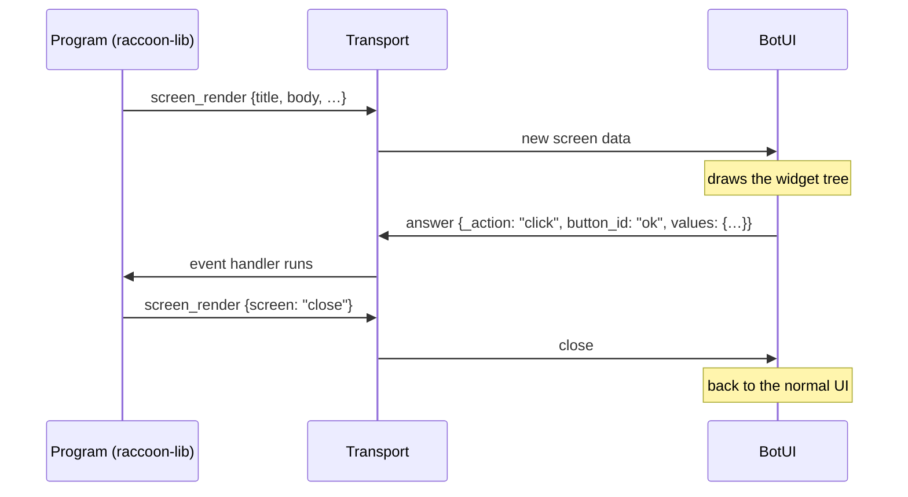

# Dynamic Screens

While a program runs, it can put its own screens on the display: a calibration wizard, a "press the button to start" prompt, a progress indicator, a live sensor view. These are called **dynamic screens**. BotUI does not know any of them in advance. It receives a description of the screen from your program, draws it, and sends your taps back.

This page describes what BotUI does with such a screen. To *show* a screen from your Python code, see [UI Steps & Screens]() in the programming guide. You do not need this page to use the built-in screens; it helps when you build your own screens, or when a screen does not behave as expected.

## The Protocol

Two transport channels carry everything ([Transport]()):

| Channel | Direction | Content |
|---------|-----------|---------|
| `raccoon/screen_render` | program → BotUI | The screen to show, as JSON |
| `raccoon/screen_render/answer` | BotUI → program | What the user did, as JSON (sent reliably) |



BotUI subscribes to `screen_render` as soon as it starts, so a program can show a screen at any time. A screen is always sent with the name `dynamic_ui`; any other name is ignored.

### What the Program Sends

A screen is a JSON object:

```json
{
  "title": "Distance Calibration",
  "setup_timer": { "seconds": 120, "paused": false },
  "body": {
    "widget": "column",
    "children": [
      { "widget": "text", "text": "Push the robot 30 cm", "size": "large" },
      { "widget": "numericinput", "id": "distance", "value": 30, "unit": "cm" },
      { "widget": "button", "id": "next", "label": "Next", "style": "primary" }
    ]
  }
}
```

| Field | Meaning |
|-------|---------|
| `title` | Text in the top bar |
| `body` | The root widget (see below) |
| `setup_timer` | Optional countdown in the top bar |
| `"screen": "close"` | A message with this field closes the screen |

Sending a new screen replaces the old one in place. The same widget tree is simply drawn again, there is no opening and closing in between. A program can update a screen many times per second; BotUI limits the update rate to about 10 per second and always draws the last one of a burst, so nothing gets lost and the Pi is not overloaded.

### What BotUI Sends Back

Every answer has an `_action`, the current `values` of all input widgets (by their `id`), and the details of the event:

| `_action` | Sent when | Extra fields |
|-----------|-----------|--------------|
| `click` | a button is tapped | `button_id` |
| `change` | an input widget changes | `widget_id`, `value` |
| `keypad` | a key of a number pad is tapped | `key` |

`values` starts from the `value` of every widget that has an `id` and a `value` in the screen, and is updated on every change.

## Widgets

The `body` is a tree. Layout widgets contain other widgets in `children`.

### Layout

| Widget | Fields | Notes |
|--------|--------|-------|
| `column` | `children`, `align` (stretch), `spacing` (12) | Vertical |
| `row` | `children`, `align` (center), `spacing` (8) | Horizontal |
| `center` | `children` | Centers its content |
| `container` | `children`, `bg_color`, `padding` | A box with a background |
| `card` | `children`, `title`, `padding` (16) | A box with a border and an optional title |
| `split` | `left`, `right`, `ratio` | Two columns next to each other |
| `expanded` | `child`, `flex` (1) | Takes the remaining space in a row or column |
| `spacer` | `height` (16) | Empty space |
| `divider` | `thickness`, `color` | A line |

A body without a `widget` field that has `children` is treated as a column.

### Text and Status

| Widget | Fields |
|--------|--------|
| `text` | `text`, `size` (`small` 14, `medium` 18, `large` 24, `title` 48, `xlarge` 72, `xxlarge` 96), `bold`, `muted`, `align`, `color` |
| `icon` | `name`, `size` (24), `color` |
| `statusbadge` | `text`, `color`, `glow` |
| `statusicon` | `icon` (default `check`), `color` (green), `animated` (true) |
| `hintbox` | `text`, `icon` (`touch_app`), `style` (`prominent` for a big one) |
| `distancebadge` | `value`, `unit` (cm), `color` |
| `resultstable` | `rows`: list of lists |
| `progressspinner` | `size` (24), `color` (orange) |

Colors are `grey`, `green`, `amber`, `orange`, `red`, `blue`, `white`, `black`, or a hex value such as `#FF8800`.

### Input

Input widgets have an `id`. Their value is part of every answer.

| Widget | Fields | Value |
|--------|--------|-------|
| `button` | `id`, `label`, `style` (`primary`, `secondary`, `success`, `danger`, `warning`), `icon`, `disabled` | Sends `click` |
| `slider` | `id`, `min` (0), `max` (100), `value`, `label`, `show_value` (true) | Number |
| `circularslider` | `id`, `min`, `max`, `value`, `label` | Number |
| `checkbox` | `id`, `label`, `value` | Boolean |
| `dropdown` | `id`, `options`, `value`, `label` | Selected string |
| `numericinput` | `id`, `value`, `unit`, `show_adjust_buttons` (true) | Number, with plus and minus buttons |
| `textinput` | `id`, `value`, `label`, `placeholder` | String |
| `numerickeypad` | | Sends `keypad` events for each key |

### Live Data and Animation

| Widget | Fields | Shows |
|--------|--------|-------|
| `sensorvalue` | `port`, `sensor_type` (`analog` or `digital`, default `analog`) | The current value of that port (read directly from the transport, no round trip to the program) |
| `sensorgraph` | `port`, `sensor_type` (`analog` or `digital`), `max_points` (50) | A live graph of that port |
| `calibrationchart` | `samples`, `thresholds`, `series`, `height` (200) | The chart of an IR sensor calibration |
| `camfeed` | `id`, `show_fps`, `show_detections` (true), `tappable` | The live camera picture, optionally with detections. If `tappable`, a tap sends a `change` for the widget's `id` with the value `{"x": …, "y": …}`. |
| `lightbulb` | `is_on` | A light bulb that is on or off |
| `animatedrobot` | `moving`, `size` (120) | A robot that drives or stands |
| `robotdrivinganimation` | `target_distance` (30) | A robot driving the given distance |
| `measuringtape` | `distance` (30) | A measuring tape |
| `pulsingarrow` | | A pulsing arrow |

An unknown widget name is drawn as red text `Unknown widget: <name>` and the rest of the screen still works. If you see this, the library is newer than BotUI (check [Versions]()) or the name is misspelled.

## Setup Timer

If the screen has a `setup_timer`, a countdown is shown at the right of the top bar. The Botball setup period is the typical use.

```json
"setup_timer": { "seconds": 120, "paused": false }
```

- BotUI counts down by itself, once per second, so the program does not have to send a message every second.
- The counter only jumps when the `seconds` value in a new message **changes**. A screen update with the same `seconds` does not disturb the running count.
- `"paused": true` freezes it.
- The timer is **green** above 30 s, **orange** at 30 s and below, **red** at 10 s and below, and keeps counting into negative numbers (overtime, shown with a minus sign and a red border). A paused timer is grey.

## How a Dynamic Screen Fits Into BotUI

- **It covers everything.** A dynamic screen is drawn above all other screens and overlays. The low-battery popup and the hardware-shutdown popup are hidden while it is up, so they cannot block the screen of a running program. The program decides when it ends.
- **No back button.** The system back gesture does nothing, and the top bar has no back arrow. Only the program (by sending `close`) removes the screen.
- **The Dev Menu stays on top.** [Holding button 10]() for 2 seconds opens the Dev Menu above a dynamic screen, so you can always stop a program that is stuck on a screen.
- **The screensaver gives way.** If the screensaver is up when a screen opens, it is dismissed. While a screen is open, the screensaver does not start.

## Troubleshooting

| Symptom | Likely reason |
|---------|---------------|
| A screen never shows | The program is not publishing on `raccoon/screen_render`, or `raccoon-transport` is not in the same bundle version as BotUI ([Settings → Versions]()) |
| The screen is stuck after the program ended | The program crashed before it sent `close`. Stop it from the [Dev Menu]() and use **Restart UI** if the screen stays. |
| Buttons do nothing | The button is `disabled`, or the program does not handle the `id` that comes back |
| The display freezes while logic continues | The rendering pipeline stalled, see below |

If the display freezes while the program keeps running (some very busy screens on the Pi 3 can do this), the frame stall watchdog notices after a few seconds, tries to get the pipeline going again and otherwise restarts the UI. See [Under the Hood]().
