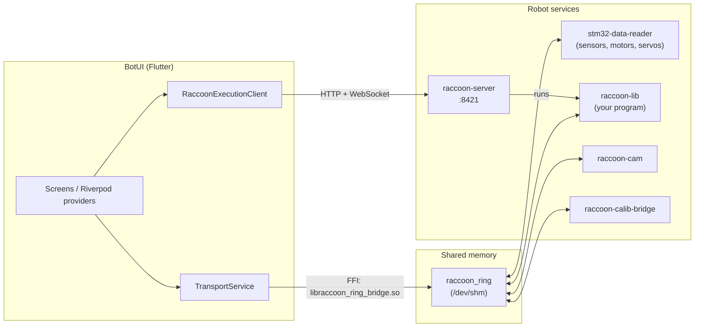
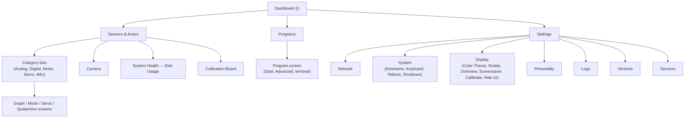

# BotUI

BotUI is the touchscreen app on the Raspberry Pi inside every RaccoonOS robot. It shows live sensor data, starts and stops your programs, manages the network, and shows the screens your program asks for while it runs. You can do all of this without a laptop or an SSH session.

It is a Flutter app (package name `stpvelox`) that runs on `flutter-pi`, directly on the Pi's framebuffer. There is no desktop environment. The display is 800×480 and the app also works rotated (see [Settings → Display]()).

## What BotUI Is (and Is Not)

BotUI does not contain any robot logic. It is a window into the services that already run on the robot, and a remote control for them:

- **Live hardware data** (sensors, motors, servos, IMU, battery, camera) comes over the shared-memory transport (`raccoon_ring`). BotUI only subscribes and publishes on named channels.
- **Running programs, logs and versions** go through the `raccoon-server` on `localhost:8421`. BotUI is a client of that server, like `raccoon run` on your laptop.
- **System settings** (hostname, keyboard, Wi-Fi, services, reboot) are done by running OS commands (`systemctl`, `hostnamectl`, NetworkManager, …) with `sudo`. The settings live in the OS, not in BotUI.

## How BotUI Talks to the Robot

**Transport.** `libraccoon_ring_bridge.so` is a small C++ library that is built into every BotUI package. It exposes the `raccoon_ring` API to Dart through FFI. `TransportService` is the single entry point in the app. Every screen subscribes to a channel (for example a sensor value) or publishes on one (for example a motor command). A timer drains the incoming frames about 30 times per second and hands them to Riverpod providers, which rebuild the widgets. The channel list is in [Transport]().

**Execution server.** To start, stop or inspect a program, BotUI calls the `raccoon-server`:

| What | How |
|------|-----|
| Start a program | `POST /api/v1/run/<project>` |
| Live output | WebSocket `/ws/output/<command>` |
| Stop | `POST /api/v1/commands/<command>/cancel` |
| Is something running? | `GET /api/v1/commands/running` |
| Logs of earlier runs | `GET /api/v1/logs/<project>/runs` |
| Component versions | `GET /version` |

BotUI reads the API token from `/home/pi/.raccoon/api_token`. On a machine without this file (for example when you try the UI on your PC) the server features simply stay empty or show an error.

## Screen Map

Navigation is a stack: every screen has a back arrow in the top bar, and the top bar also shows the battery voltage. Two things sit outside this tree, because they must be reachable from anywhere: the [dynamic screens]() your program can show, and the [Dev Menu]().

## Section Overview

| Page | What you will find |
|------|--------------------|
| [Dashboard]() | The home screen: overview panel, menu tiles, screensaver |
| [Sensors & Actors]() | Sensor graphs, motor and servo control, camera, system health |
| [Programs]() | Starting, watching and stopping programs, sync state |
| [Settings]() | Network, system, display, personality, logs, versions, services |
| [Calibration Board]() | USB-C board for optical-flow odometry and IMU calibration |
| [Dynamic Screens]() | Screens your program shows on the display, and the answers it gets back |
| [Dev Menu]() | Stop a program, restart the UI, reboot, reset the STM32, games |
| [System Popups]() | Low battery, hardware shutdown, version mismatch, error and Ethernet dialogs |
| [Screenshots]() | Triple-click the built-in button to save a screenshot |

## Installing and Building BotUI

BotUI is part of the RaccoonOS image and is updated with `raccoon update`, so normally there is nothing to install. To build your own version, deploy it to a robot, or try the UI in a window on your PC, see [Build System → botui]().

## Under the Hood

A few details that explain how BotUI behaves on the Pi:

- **Touch debounce.** The resistive touchscreen often reports one press as several quick presses. A filter in front of the whole app drops a press that starts within 150 ms and 30 px of the last accepted one.
- **Touch calibration.** The calibration matrix from [Settings → Display → Calibrate]() is applied to every tap.
- **Frame stall watchdog.** On the Pi 3 the rendering pipeline can occasionally freeze while the app logic keeps running. A watchdog notices that no frame was drawn, tries to wake the pipeline, and if that fails exits the app. `flutter-ui.service` is set to `Restart=always` with a 2 s delay, so the UI comes back by itself after a brief flicker.
- **Colors.** Screens never hardcode a color. A tile asks for a named slot (red, green, blue, …) and the active [color theme]() decides what it looks like.
