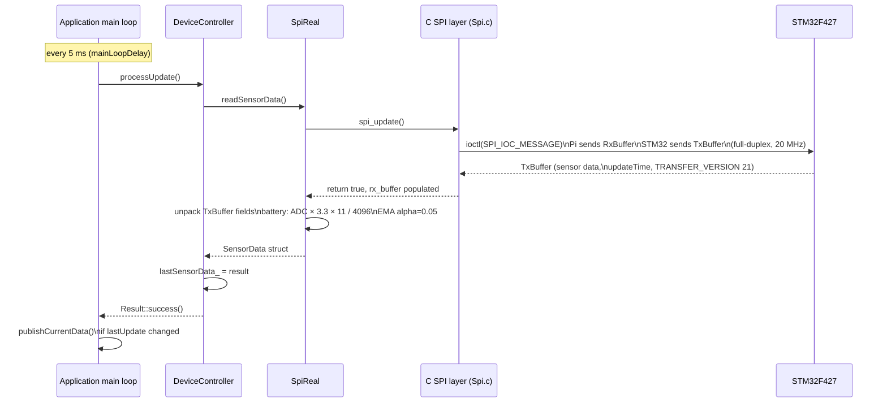
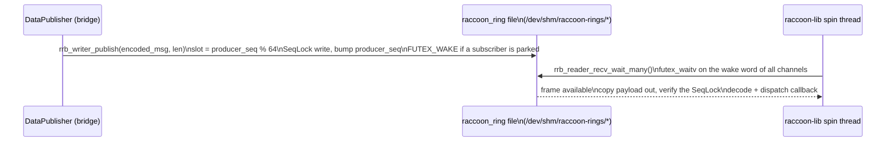
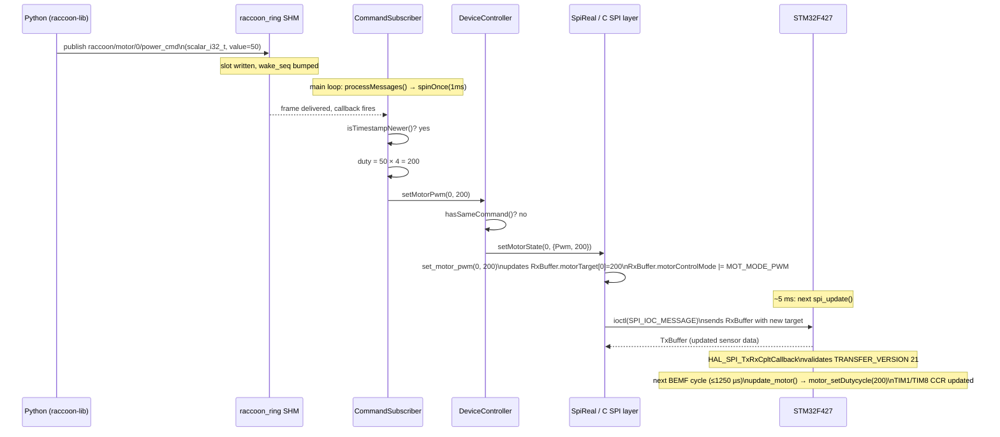

## Concept

Every sensor reading your Python code receives, and every motor command your Python code sends, travels through a five-stage pipeline that spans two processors, two buses, and three IPC mechanisms.

Understanding this pipeline helps you reason about **latency** (why sensor reads are always slightly stale), **reliability** (why retained channels exist), and **architecture** (why `from raccoon_transport import Transport` is the low-level API and `get_transport()` is what project services should use).

```mermaid
graph LR
    subgraph STM32["STM32F427 — Hard Real-Time"]
        HW["Physical sensor\nor motor"]
        ISR["ADC1 DMA (250 Hz)\nBEMF ADC2 (800 Hz)\nIMU DMP (50 Hz)\nDigital GPIO"]
        TX["TxBuffer\n(volatile packed struct,\nTRANSFER_VERSION 21)"]
    end

    subgraph SPIBus["SPI2 — Full-Duplex\n20 MHz, ~5 ms poll cycle"]
        WIRE["ioctl(SPI_IOC_MESSAGE)\nTxBuffer ⇄ RxBuffer\nBUFFER_LENGTH_DUPLEX_COMMUNICATION bytes"]
    end

    subgraph Reader["stm32-data-reader (C++, wombat ns)"]
        UNPACK["SpiReal::readSensorData()\nunpack + unit-convert\n(ADC counts → V, EMA filter)"]
        GATE["DataPublisher\nPublishGate 50 Hz cap\n+ L∞ noise epsilon"]
        PUB["LcmBroker\nserialise + dedup\nraccoon::Transport"]
    end

    subgraph SHM["raccoon_ring SHM\n(/dev/shm/raccoon-rings/*)"]
        RING["64-slot × 2 KiB ring\nper channel\nSeqLock, futex wake"]
    end

    subgraph Lib["raccoon-lib (Python)"]
        LCMR["TransportReader\nspinOnce() thread\nfutex_waitv"]
        CACHE["mutex-protected\nper-channel cache"]
        API["motor.get_position()\nanalog.read()\nimu.heading()"]
    end

    HW --> ISR --> TX
    TX --> WIRE --> UNPACK --> GATE --> PUB --> RING
    RING --> LCMR --> CACHE --> API
```



The reverse direction (Python command → motor output) follows the same path in reverse: Python publishes to a `hardware/motor/N/cmd/power` transport channel, the reader's `CommandSubscriber` picks it up, writes the `RxBuffer`, and the next SPI transfer delivers it to the STM32.

This page traces a complete data path from a physical sensor reading to a value accessed in user Python code, and a complete command path from Python code to motor movement.

## Sensor Data Path (STM32 → Python)

```
Physical sensor
      │
      ▼
STM32 ADC / GPIO / IMU
      │  (interrupt-driven, µs latency)
      ▼
txBuffer (volatile struct in STM32 RAM)
      │  (updated after each measurement cycle)
      ▼
SPI2 DMA transfer to Raspberry Pi
      │  (circular DMA, Pi polls at main-loop rate)
      ▼
stm32-data-reader: SpiReal::readSensorData()
      │  (spi_update() call in C, copies RxBuf → TxBuf,
      │   returns SensorData struct)
      ▼
stm32-data-reader: DataPublisher::publishSensorData()
      │  (serialises fields to transport messages, publishes
      │   via raccoon::Transport using raccoon_ring SHM)
      ▼
raccoon_ring shared memory (/dev/shm/raccoon-rings/<channel>)
      │  (primary IPC; one ring-buffer file per channel)
      ▼
raccoon-lib: TransportReader (callbacks on the shared spin thread)
      │  (raccoon::Transport::spinOnce, updates caches)
      ▼
TransportReader caches (mutex-protected std::unordered_map
      │   / scalar fields)
      ▼
Python binding call (e.g., motor.get_position(),
      analog.read(), imu.heading())
```

### Step 1: STM32 Hardware Layer

**Analog sensors and battery:** ADC1 runs in **continuous circular DMA mode**, started once at boot by `startContinuousAnalogSampling()`. DMA streams results into an oversampling accumulator continuously. TIM6 fires at `ANALOG_OUTPUT_INTERVAL` (4000 µs = 250 Hz): the accumulator is snapshotted, averaged, VDDA-corrected, and written to `txBuffer`. There is no separate `ANALOG_SENSOR_SAMPLING_INTERVAL` constant.

**Digital sensors:** `readDigitalInputs()` is called directly from `HAL_SPI_TxRxCpltCallback` and the result written into `txBuffer.digitalSensors`. Digital sensors are updated on every single SPI transaction.

**BEMF and motor state:** TIM6 calls `stop_motors_for_bemf_conv()` every **1250 µs** (one motor at a time, round-robin). After 500 µs settle time, ADC2 DMA conversion runs for the current motor's two channels. On ADC2 completion, BEMF is processed through the two-stage filter (median-of-3 + IIR α=0.2), offset-corrected, dead-zone applied, and dt-aware position integration runs. The motor control loop re-applies the PWM command. `updatingMotorsInSpiBuffer()` copies `motor_data` into `txBuffer.motor` after confirming SPI2 is idle. Each motor is measured every 4 × 1250 = 5000 µs (200 Hz effective per motor).

**IMU:** Main loop calls `readImu()`. When the MPL has new fused data, `txBuffer.imu` is updated.

### Step 2: SPI Transfer

The Pi initiates SPI transactions by calling `spi_update()` in the C SPI layer. This performs a synchronous `ioctl(SPI_IOC_MESSAGE)` on `/dev/spidev0.0` — a single system call that transfers `BUFFER_LENGTH_DUPLEX_COMMUNICATION` bytes (the `max(sizeof(TxBuffer), sizeof(RxBuffer))` at compile time) in both directions simultaneously.



The Pi sends the current `RxBuffer` (commands: motor modes, targets, servo positions, PID gains, feature flags) while simultaneously receiving the STM32's `TxBuffer` (sensor data, motor telemetry, IMU, odometry). **Both directions happen in one system call with no gaps.**

The protocol version field (`TxBuffer.transferVersion = 21`, `TRANSFER_VERSION 21` in `pi_buffer.h`) is checked once at startup via `spi_probe_version()`. A mismatch triggers an automatic firmware reflash on the next update call.

The Pi's `stm32-data-reader` calls `spi_update()` on every main-loop iteration. The default `mainLoopDelay` is **5 ms** (`Configuration::mainLoopDelay`).

### Step 3: stm32-data-reader → transport

`SpiReal::readSensorData()` unpacks the raw `TxBuffer` into a C++ `SensorData` struct with named fields. Unit conversions that happen here:

- Battery voltage is converted from ADC counts to volts using the known 11× resistor divider and 3.3 V reference, then filtered with a 5% EMA.
- Analog sensor values are passed as raw `int16_t` counts. No physical conversion is applied in the SPI layer.
- Motor position reset is on-STM32 (via `motorPositionReset` bitmask + `PI_BUFFER_UPDATE_MOTOR_POS_RESET`); there are no Pi-side `positionOffsets_` in the current code.

`DataPublisher::publishSensorData()` serialises each field as an transport message on the raccoon transport. All channel names use the **`raccoon/` prefix**.

#### Publish-rate gating

Most IMU channels are capped to **50 Hz** with an L-infinity noise-floor epsilon to reduce transport traffic. The accelerometer is **intentionally ungated** (`publishForce`) so downstream calibration routines receive every raw frame even when consecutive values are identical.

| Channel class | Rate cap | Noise epsilon |
|---|---|---|
| Gyro | 50 Hz | 0.01 rad/s |
| Magnetometer | 50 Hz | 0.5 counts |
| Linear acceleration | 50 Hz | 0.05 m/s² |
| Accel velocity | 50 Hz | 0.05 m/s |
| DMP quaternion | 50 Hz | 0.001 (per-component) |
| Heading | 50 Hz | 0.05° |
| Temperature | 50 Hz | 0.1°C |
| Accelerometer | **ungated** | none |
| Odometry fields | 50 Hz | 0 (any change passes) |

#### transport channel table

All topics below are on `raccoon::Transport` (shared-memory `raccoon_ring`). Message types are the `raccoon::` types of raccoon-transport.

| transport channel | Message type | Content | Retained? |
|---|---|---|---|
| `hardware/imu/state/gyro` | `vector3f_t` | angular velocity (rad/s) | no |
| `hardware/imu/state/accel` | `vector3f_t` | acceleration (m/s²), ungated | no |
| `hardware/imu/state/linear_accel` | `vector3f_t` | gravity-removed accel (m/s²) | no |
| `hardware/imu/state/accel_velocity` | `vector3f_t` | integrated accel velocity (m/s, decay 0.998/cycle) | no |
| `hardware/imu/state/mag` | `vector3f_t` | magnetometer (raw counts) | no |
| `hardware/imu/state/quaternion` | `quaternion_t` | DMP 6-axis orientation (w, x, y, z) | no |
| `hardware/imu/state/heading` | `scalar_f_t` | degrees, mag-corrected when calibrated | yes |
| `hardware/imu/state/temperature` | `scalar_f_t` | IMU temperature (°C) | no |
| `hardware/imu/state/gyro_accuracy` | `scalar_i8_t` | gyro calibration accuracy 0–3 | no |
| `hardware/imu/state/accel_accuracy` | `scalar_i8_t` | accel calibration accuracy 0–3 | no |
| `hardware/imu/state/mag_accuracy` | `scalar_i8_t` | compass calibration accuracy 0–3 | no |
| `hardware/imu/state/quaternion_accuracy` | `scalar_i8_t` | quaternion accuracy 0–3 | no |
| `hardware/battery/state/voltage` | `scalar_f_t` | battery voltage (volts) | yes |
| `hardware/analog/N/state/value` | `scalar_i32_t` | raw ADC counts for port N | no |
| `hardware/digital/N/state/value` | `scalar_i32_t` | 0 or 1 for digital port N | no |
| `hardware/motor/N/state/bemf` | `scalar_i32_t` | filtered + offset-corrected BEMF ticks | yes |
| `hardware/motor/N/state/power` | `scalar_i32_t` | last commanded duty (−399 to +399) | yes |
| `hardware/motor/N/state/position` | `scalar_i32_t` | accumulated BEMF ticks (dt-aware) | yes |
| `hardware/servo/N/state/mode` | `scalar_i8_t` | servo mode state (reader→UI, not commands) | yes |
| `hardware/servo/N/state/position` | `scalar_f_t` | servo position (degrees) | yes |
| `hardware/servo/N/state/feedback` | `vector3f_t` | bus servo: x=position (deg, multi-turn), y=speed (deg/s), z=load (% of max torque, signed) | yes |
| `hardware/servo/N/state/health` | `vector3f_t` | bus servo: x=voltage (V), y=temperature (°C), z=error bits (−1 = no servo answers) | yes |
| `hardware/servo/N/state/done` | `scalar_i32_t` | bus servo: 0 = moving, 1 = reached, 2 = stalled | yes |
| `hardware/odometry/state/pos_x` | `scalar_f_t` | world-frame x (meters) | yes |
| `hardware/odometry/state/pos_y` | `scalar_f_t` | world-frame y (meters) | yes |
| `hardware/odometry/state/heading` | `scalar_f_t` | heading (radians, CCW+) | yes |
| `hardware/odometry/state/vx` | `scalar_f_t` | body-frame vx (m/s) | yes |
| `hardware/odometry/state/vy` | `scalar_f_t` | body-frame vy (m/s) | yes |
| `hardware/odometry/state/wz` | `scalar_f_t` | body-frame wz (rad/s) | yes |
| `hardware/feature/state/bemf_active` | `scalar_i32_t` | BEMF enable state (0 or 1) | yes |
| `hardware/latch/state/flags` | `scalar_i32_t` | shutdown bitmask (bits: servo, motor, watchdog-source) | yes |
| `messages/error` | `string_t` | STM32 UART error messages | no |
| `system/state/cpu_temperature` | `scalar_f_t` | Pi CPU temperature (°C) | no |

"Retained" channels use `publishRetained()`. A new subscriber that calls `subscribeWithRetain` immediately receives the last published value without waiting for the next SPI cycle. This is important for motor position and battery voltage, where a late subscriber must not block waiting for the next update.

IMU accuracy channels (`gyro/accuracy`, `accel/accuracy`, `mag/accuracy`, `imu/quaternion_accuracy`) are published only when the accuracy value changes, not on every loop.

### Step 4: raccoon-transport

The [Transport]() carries every value from the bridge to its subscribers (raccoon-lib, BotUI, diagnostic tools). Each channel is one ring file `/dev/shm/raccoon-rings/<channel with . for />` with the slots and slot size that the channel table gives it. The publisher copies the encoded message into the next slot and wakes parked subscribers with a futex. A subscriber that is too slow loses old frames and never blocks the publisher. You can list the files with `ls /dev/shm/raccoon-rings/`.



**Retained channels:** `publishRetained()` marks a channel so that a new subscriber starts at the latest frame in the ring and gets the last value immediately. Battery voltage, motor position, servo state, odometry, heading and BEMF are retained for this reason.

**Restart:** when `stm32-data-reader` restarts it attaches to the existing ring files, and subscribers keep running. Do not delete the files in `/dev/shm/raccoon-rings/` while components run.

**Namespace:** `stm32_data_reader.service` sets `PrivateTmp=false` so the ring files are visible to every process, see [Robot Services and systemd]().

Reliable command delivery uses the same ring: the publisher re-sends until the subscriber acknowledges on the internal `__raccoon/ack` channel. Nothing goes over the network; the old `lcm-loopback-multicast.service` no longer exists.

### Step 5: raccoon-lib HAL

`TransportReader` is a singleton that subscribes to the sensor channels and keeps mutex-protected caches of the latest value. The callbacks run on `SharedTransport`'s one spin thread, which parks in `futex_waitv` and wakes on every publish. Each HAL class (Motor, Analog, Digital, IMU) calls the appropriate `TransportReader::read*()` method, which takes the lock and returns the cached value. Sensor reads in user code are non-blocking and always return the most recently observed value.

## Command Path (Python → STM32)

```
Python: motor.set_speed(50)
      │
      ▼
raccoon-lib::hal::motor::Motor::setSpeed()
      │  (maps percent to signed duty, applies inversion)
      ▼
TransportWriter::setMotor(port, duty)
      │  (publishes scalar_i32_t to hardware/motor/N/cmd/power)
      ▼
raccoon_ring SHM (/dev/shm)
      │
      ▼
stm32-data-reader: CommandSubscriber::onMotorPowerCommand()
      │  (maps percent → duty: duty = percent × 4)
      ▼
DeviceController::setMotorPwm()
      │
      ▼
SpiReal::setMotorPwm()
      │  (calls C API: set_motor_pwm(port, duty))
      ▼
C SPI layer: updates rxBuffer in Pi's memory
      │
      ▼
Next spi_update() call: Pi sends updated rxBuffer to STM32
      │  (full-duplex SPI transaction)
      ▼
STM32: rxBuffer updated by DMA
      │  (SPI completion callback fires)
      ▼
HAL_SPI_TxRxCpltCallback validates version
      │
      ▼
Next BEMF cycle (≤ 1250 µs): update_motor() reads motorControlMode
      │  and motorTarget, calls motor_setDutycycle()
      ▼
TIM1/TIM8 compare register updated
      │
      ▼
Motor PWM changes
```

The following sequence diagram shows the timing of a motor power command in detail, including where the main loop interleaves with the command subscriber:



### transport command channels

| Channel | Message type | Reliable? | Purpose |
|---|---|---|---|
| `hardware/motor/N/cmd/power` | `scalar_i32_t` | no | open-loop PWM (−100 to +100%) |
| `hardware/motor/N/cmd/velocity` | `scalar_i32_t` | no | MAV velocity setpoint (BEMF ticks/s) |
| `hardware/motor/N/cmd/position` | `vector3f_t` | yes | MTP: x=speed_limit, y=goal_position |
| `hardware/motor/N/cmd/reset_position` | `scalar_i32_t` | yes | reset motor N position on STM32 |
| `hardware/motor/N/cmd/stop` | `scalar_i32_t` | yes | stop motor N (passive brake) |
| `hardware/motor/N/cmd/mode` | `scalar_i32_t` | yes | set raw motor control mode |
| `hardware/motor/N/cmd/pid` | `vector3f_t` | yes | override PID: x=kp, y=ki, z=kd |
| `hardware/chassis/cmd/velocity` | `vector3f_t` | no | chassis velocity: x=vx, y=vy, z=wz |
| `hardware/servo/N/cmd/mode` | `scalar_i8_t` | yes | servo mode (separate from state channel) |
| `hardware/servo/N/cmd/position` | `scalar_f_t` | yes | servo target angle (degrees) |
| `hardware/servo/N/cmd/smooth` | `vector3f_t` | yes | smooth servo: x=angle, y=speed, z=easing |
| `hardware/servo/N/cmd/velocity` | `scalar_f_t` | yes | bus servo: continuous rotation in deg/s (signed) |
| `hardware/odometry/cmd/reset` | `scalar_i32_t` | yes | reset odometry |
| `hardware/kinematics/cmd/config` | (kinematics type) | yes | send KinematicsConfig to STM32 |
| `hardware/watchdog/cmd/heartbeat` | `scalar_i32_t` | no | MotorWatchdog heartbeat |
| `hardware/latch/cmd/engaged` | `scalar_i32_t` | yes | system shutdown command |
| `hardware/feature/cmd/bemf_active` | `scalar_i32_t` | yes | enable/disable BEMF at runtime |

**Servo mode vs. servo mode command:** The servo mode channel is split into two: `hardware/servo/N/state/mode` (state, reader publishes) and `hardware/servo/N/cmd/mode` (command, raccoon-lib publishes). This prevents the reader from subscribing to its own publishes, which previously caused a ~5 ms internal latency floor.

### Bus Servo Channels {#bus-servo-channels}

A servo port can drive a Feetech STS serial bus servo (e.g. STS3215) instead of a PWM servo. Which one it is depends on the port's servo mode, which is set on `hardware/servo/N/cmd/mode`:

| Value | Mode |
|-------|------|
| 0 | Fully disabled (PWM off, 6 V supply off if all servos are) |
| 1 | Disabled (PWM off for this servo) |
| 2 | PWM servo enabled |
| 3 | Bus servo |

Setting mode 3 hands the pin from the PWM timer to the bus and leaves the servo **relaxed** (torque off). The STM32 then searches for one servo on the port, whatever its ID is, and reports it on the health channel. A servo that stops answering is searched for again.

The same command channels as for PWM servos drive a bus servo, with these meanings:

| Channel | On a bus servo |
|---------|----------------|
| `cmd/position` | Go to the angle (0–360°) at the servo's maximum speed, then hold |
| `cmd/smooth` | Go to x=angle at y=speed (deg/s). The servo runs the ramp itself; z=0 uses its default acceleration, any other easing uses a ramp over about the first third of the move |
| `cmd/velocity` | Turn continuously at the given signed speed |
| `cmd/mode` = 3 while already in bus mode | Relax the servo (torque off) |

The servo has 4096 steps per revolution. `feedback` reports the position in degrees, unwrapped by the STM32, so it keeps counting past 360° and goes negative when the servo is turned back. `done` refers to the latest command: it is `0` until the move has finished, then `1` (target reached) or `2` (the servo stopped before the target). The error bits of `health` are `0x01` voltage, `0x02` sensor, `0x04` overheat, `0x08` current, `0x10` angle and `0x20` overload.

`cmd/velocity` is the only command that fails on a PWM port: the reader logs an error and ignores it.

### Reliable Commands

Commands that must not be lost (position targets, PID configuration, servo mode changes, shutdown, position resets) are on reliable channels of the channel table. Reliable delivery is implemented in `raccoon::Transport`: the sender repeats a frame until the receiver acknowledges it, and the receiver delivers each command once.

Continuous commands (motor power percentage, motor velocity) are sent without reliable delivery to avoid queuing stale commands. If a power command is dropped, the next iteration of the user's control loop sends a fresh one.

### Timestamp-Based Deduplication

The `CommandSubscriber` tracks the timestamp of the most recently applied command per channel. If a message arrives with a timestamp older than the last applied message (possible if messages arrive out of order, for example re-sends of a reliable command), it is silently dropped. This is the `isTimestampNewer()` check.

## Timing Budget

| Stage | Typical latency |
|---|---|
| Sensor measurement to txBuffer | 0–5 ms (BEMF-dominated) |
| SPI transfer | < 1 ms |
| stm32-data-reader main loop | < 5 ms (mainLoopDelay = 5 ms) |
| raccoon_ring SHM delivery | < 0.1 ms |
| TransportReader cache update | < 0.1 ms |
| Python read call | < 0.1 ms (non-blocking) |
| **Total sensor→Python** | **< 12 ms** |

Command latency follows the same path in reverse; the dominant factor is the BEMF cycle (up to 1250 µs per motor in round-robin, up to one full 4-motor rotation = 5 ms in worst case) from when the STM32 receives the new command to when the motor output actually changes.

## Related pages

- [Firmware Runtime and Scheduling](/06-advanced/04-firmware/firmware-runtime/) — ISR context, ADC interrupt rates, and super-loop scheduling that produce the data entering the pipeline
- [Pi Bridge Internals](/06-advanced/04-firmware/pi-bridge-internals/) — deep dive into `Application` lifecycle, `SpiReal` vs `SpiMock`, `DataPublisher` gate logic, `CommandSubscriber`, `MotorWatchdog`, `LcmBroker`, and `raccoon_ring` internals
- [SPI Communication Protocol](/06-advanced/04-firmware/spi-protocol/) — the wire format and all transport channel names
- [Motor Control](/06-advanced/04-firmware/motor-control/) — what happens inside each BEMF cycle
- [IMU Stack](/06-advanced/04-firmware/imu/) — how `txBuffer.imu` fields are produced by the MPL fusion pipeline
- [Robot Services And systemd](/06-advanced/04-firmware/robot-services-and-systemd/) — how `stm32_data_reader.service` fits into the full service topology
