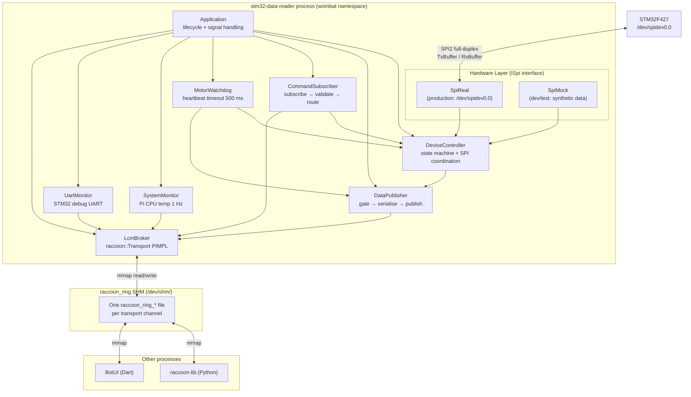
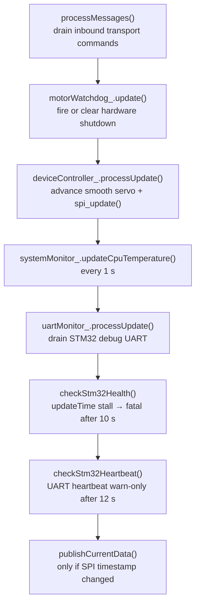

## Mental model

The `stm32-data-reader` is a C++20 daemon that lives entirely on the Raspberry Pi and acts as the translation layer between the STM32 coprocessor and the rest of the robot software stack. Think of it as a protocol gateway with three faces:

- **Toward the STM32:** speaks SPI binary protocol, translates packed C structs into typed C++ objects.
- **Toward user code and services:** speaks transport publish/subscribe over `raccoon_ring` shared memory, presenting well-named `raccoon/*` channels.
- **Toward the system:** owns the hardware safety watchdog, resets the STM32 on startup, monitors health.

Understanding the bridge means understanding exactly what runs in one process, what the main loop does on each iteration, and how the hardware abstraction layer lets the same binary run against either real SPI hardware or a software simulator.



## Application lifecycle

`Application` (`src/wombat/Application.cpp`) is the root object. It owns all services as `shared_ptr` or `unique_ptr` members and coordinates their lifecycle in a fixed sequence.

### Initialization sequence

The `Application::initialize()` → `Application::initializeServices()` chain runs these steps in order:

1. **Logger** is created first so all subsequent steps can log.
2. **LcmBroker** is instantiated and connected to the logger so it can publish error messages to `raccoon/errors`.
3. **SPI hardware** (`SpiReal` or `SpiMock`) is constructed and wrapped in `DeviceController`.
4. **DataPublisher**, **CommandSubscriber**, **SystemMonitor**, and optionally **UartMonitor** are created.
5. **LcmBroker is initialized** — this opens the `raccoon::Transport` and connects to the SHM ring backend. Must complete before any publish or subscribe call.
6. **UartMonitor is initialized** (if enabled) before the STM32 reset so the Pi captures boot UART output.
7. **STM32 reset** is triggered via `spi_reset_stm32()` (calls a shell reset script and waits 1 s). The UART monitor then drains boot output for 2 s.
8. **DeviceController is initialized** — this calls `spi_->initialize()` which opens `/dev/spidev0.0` at 20 MHz and sets SPI mode, then initializes all motor and servo ports to safe defaults.
9. **Protocol version probe** — `spi_probe_version()` reads `TRANSFER_VERSION` (21) from the live STM32. A mismatch logs a warning and triggers automatic firmware reflash on the next SPI update.
10. **CommandSubscriber is initialized** — registers all transport subscriptions (see below).
11. **Startup feature flags** — if `disableBemfOnStartup` is set in config, `FEATURE_BEMF_DISABLE` is written to `RxBuffer.featureFlags` immediately, enabling speed mode from the first SPI transfer.

### Main loop

`Application::run()` calls `processMainLoop()` every `mainLoopDelay` (default **5 ms**). Each iteration:



**Health checks:** `checkStm32Health()` watches the `updateTime` field in `TxBuffer`. If this 32-bit timestamp has not changed for more than 10 seconds, the bridge shuts down with a fatal error — this is the authoritative SPI liveness check. The UART heartbeat (`checkStm32Heartbeat()`) is diagnostic-only; it emits a warning after 12 s of silence but never kills the process, because the STM32 firmware intentionally disables UART TX interrupts for over 12 s while writing IMU calibration to flash.

**Publish deduplication:** `publishCurrentData()` compares `sensorData.lastUpdate` to `lastPublishedTimestamp_`. If the timestamp has not changed since the last loop, the entire publish block is skipped. This is distinct from the per-channel gate logic inside `DataPublisher`.

### Shutdown sequence

`Application::shutdown()` tears down in reverse initialization order: UartMonitor → CommandSubscriber → DeviceController → LcmBroker. DeviceController sets the firmware shutdown flag (`setShutdown(true)`) before closing the SPI file descriptor, so the STM32 cuts PWM output before the Pi loses the SPI link.

Signal handling registers `SIGINT` / `SIGTERM` handlers via a global `Application*` pointer that sets `shouldShutdown_`.

## SpiReal vs SpiMock

The bridge is built with a `ISpi` interface (`include/wombat/hardware/ISpi.h`) that both implementations satisfy:

```cpp
class ISpi {
    virtual Result<SensorData> readSensorData() = 0;
    virtual Result<void> setMotorState(PortId port, const MotorState& state) = 0;
    virtual Result<void> setChassisVelocity(float vx, float vy, float wz) = 0;
    // ... and so on for all actuation and telemetry
};
```

The concrete implementation is selected at compile time with `USE_SPI_MOCK`:

```bash
# Production (cross-compiled for the Pi, in Docker)
python3 build.py

# Host development (runs on any Linux x86_64 machine)
cmake .. -DUSE_SPI_MOCK=ON -DCMAKE_BUILD_TYPE=Debug
```

### SpiReal (`src/wombat/hardware/SpiReal.cpp`)

`SpiReal::initialize()` calls `spi_init(speedHz)` (defaults to **20 MHz**) and `set_spi_mode(true)`. The C layer opens `/dev/spidev0.0` with `ioctl(SPI_IOC_WR_*)` calls to configure speed, mode, and bits-per-word.

`SpiReal::readSensorData()` calls `spi_update()`, which performs a **synchronous `ioctl(SPI_IOC_MESSAGE)`** for one full-duplex transfer of `BUFFER_LENGTH_DUPLEX_COMMUNICATION` bytes. After return it reads `get_rx_buffer()` (a pointer to the Pi's local copy of `TxBuffer`) and unpacks every field into a `SensorData` C++ struct:

- **Battery voltage:** raw `int16_t` ADC count → volts via `count × 3.3 × 11 / 4096`, then 5% EMA filtered (`alpha = 0.05`).
- **Analog values:** copied as raw `int16_t` counts; no physical unit conversion in the SPI layer.
- **Motor telemetry:** `bemf[4]` and `position[4]` unpacked per motor.
- **Odometry:** `pos_x`, `pos_y`, `heading`, `vx`, `vy`, `wz` copied directly from `OdometryData`.
- **IMU:** all fields from `ImuData` (gyro, accel, compass, linearAccel, accelVelocity, dmpQuat, heading, temperature and per-sensor accuracy).

Write operations (motor modes, servo positions, PID gains, kinematics config, feature flags) call the corresponding C API (`set_motor_pwm`, `set_servo_pos`, `set_kinematics_config`, etc.) which update `RxBuffer` in Pi memory. The updated buffer is sent to the STM32 on the **next** `spi_update()` call.

### SpiMock (`src/wombat/hardware/SpiMock.cpp`)

`SpiMock` replaces the SPI hardware with a time-based signal generator. On each `readSensorData()` call it accumulates elapsed seconds and computes:

- **Gyro:** three-axis sinusoids at 0.2 Hz base frequency.
- **Accelerometer:** gentle tilt simulation plus 1.0 g on Z.
- **IMU heading:** 180° ± 90° sinusoidal sweep.
- **Battery:** slow linear drain from 12.3 V to 10.5 V, then reset (with 2 Hz ripple).
- **Analog:** per-port deterministic base value (800, 900, ... 1300 ADC counts) with sinusoidal wobble.
- **Digital:** rotating single-bit pattern across the 16-bit field.
- **Motor BEMF/position:** toy proportional model — BEMF = `target / 4`, position = `target`.

Motor and servo write calls update an internal `motors_[4]` / `servos_[4]` array with no SPI interaction, so the round-trip from command to feedback is instantaneous in mock mode.

**Why this matters for development:** Mock mode enables running the full bridge process (LcmBroker, DataPublisher, CommandSubscriber, MotorWatchdog, SystemMonitor) on any development laptop without any robot hardware. All `raccoon/*` transport channels are published with synthetic but structurally valid data. Tools like BotUI, raccoon-lib, and integration tests can be exercised end-to-end.

## DeviceController

`DeviceController` (`src/wombat/services/DeviceController.cpp`) sits between the SPI hardware and the service layer. Its roles are:

1. **State caching:** maintains `motorStates_[MAX_MOTOR_PORTS]` and `servoCommands_[MAX_SERVO_PORTS]` so it can detect duplicate commands before touching SPI.
2. **Idempotent writes:** `setMotorState()` calls `hasSameCommand(state)` and skips the SPI call if the command is unchanged, preventing unnecessary SPI traffic.
3. **Smooth servo interpolation:** `startSmoothServo()` records a start angle, target angle, duration (= `|delta| / speed`), and easing type. Each `processUpdate()` call advances the trajectory and writes the interpolated position to SPI. `applyEasing()` supports five types: linear (0), ease-in (1), ease-out (2), smooth-step (3), cosine (4).
4. **Sensor data snapshot:** after `spi_->readSensorData()` completes, the result is stored in `lastSensorData_`. `getCurrentSensorData()` returns a copy of this snapshot without touching SPI.
5. **Chassis velocity:** `setChassisVelocity(vx, vy, wz)` first sets all four motors to `MotorControlMode::Chassis` (idempotently) then calls `spi_->setChassisVelocity()` to stage the body-frame setpoint in `RxBuffer.chassisVelocity`.

## DataPublisher

`DataPublisher` (`src/wombat/services/DataPublisher.cpp`) converts `SensorData` and `MotorState` structs into transport messages and publishes them on named `raccoon/*` channels.

### Publish variants

`LcmBroker` exposes three publish variants, each with different delivery semantics:

| Broker method | Dedup? | Retained? | When used |
|---|---|---|---|
| `publish<T>()` | yes | no | Most sensor channels (gyro, accel, analog, digital, temperature) |
| `publishForce<T>()` | no | no | Accelerometer (every frame must go through) |
| `publishRetained<T>()` | yes | yes | Battery, motor state, servo state, odometry, feature flags |

**Deduplication** is byte-level: the transport compares the encoded payload of the new message to the last published value for that channel. Command channels (names ending in `_cmd` or containing `/cmd/`) are always skipped by dedup regardless of the flag, because repeating the same command is semantically meaningful.

**Retained** means a late subscriber that calls `subscribeWithRetain` immediately receives the last published value from the ring without waiting for a new publish cycle. The ring implementation stores the latest frame in the slot at `producer_seq % slot_count` and `rrb_reader_seek_to_latest()` positions a new reader there directly.

### Rate gating

Most IMU channels are capped to **50 Hz** by a `PublishGate<T>` template. Each gate tracks `lastTime` and `lastValue`. A new sample passes the gate only if:

- At least `minInterval` (20 ms = 50 Hz) has elapsed since the last publish, AND
- The L-infinity distance (maximum absolute per-component difference) to `lastValue` exceeds `noiseEpsilon`.

Gate configuration from the constructor:

| Channel | `minInterval` | `noiseEpsilon` |
|---|---|---|
| Gyro | 20 ms | 0.01 rad/s |
| Magnetometer | 20 ms | 0.5 counts |
| Linear acceleration | 20 ms | 0.05 m/s² |
| Accel velocity | 20 ms | 0.05 m/s |
| DMP quaternion | 20 ms | 0.001 per-component |
| Heading | 20 ms | 0.05° |
| IMU temperature | 20 ms | 0.1°C |
| Odometry (all fields) | 20 ms | 0 (any change passes) |
| Accelerometer | **none** | **none** (publishForce) |

IMU accuracy channels (gyro, accel, compass, quaternion) use a change-detector instead of a gate: they are published only when the accuracy value differs from the previously published value.

### Per-channel publish summary

| Channel | Type | Gate | Retained |
|---|---|---|---|
| `raccoon/gyro/value` | `vector3f_t` | 50 Hz + 0.01 rad/s eps | no |
| `raccoon/accel/value` | `vector3f_t` | none (force) | no |
| `raccoon/linear_accel/value` | `vector3f_t` | 50 Hz + 0.05 m/s² eps | no |
| `raccoon/accel_velocity/value` | `vector3f_t` | 50 Hz + 0.05 m/s eps | no |
| `raccoon/mag/value` | `vector3f_t` | 50 Hz + 0.5 count eps | no |
| `raccoon/imu/quaternion` | `quaternion_t` | 50 Hz + 0.001 eps | no |
| `raccoon/imu/heading` | `scalar_f_t` | 50 Hz + 0.05° eps | yes |
| `raccoon/imu/temp/value` | `scalar_f_t` | 50 Hz + 0.1°C eps | no |
| `raccoon/gyro/accuracy` | `scalar_i8_t` | on-change only | no |
| `raccoon/accel/accuracy` | `scalar_i8_t` | on-change only | no |
| `raccoon/mag/accuracy` | `scalar_i8_t` | on-change only | no |
| `raccoon/imu/quaternion_accuracy` | `scalar_i8_t` | on-change only | no |
| `raccoon/battery/voltage` | `scalar_f_t` | dedup only (broker) | yes |
| `raccoon/analog/N/value` | `scalar_i32_t` | dedup only | no |
| `raccoon/digital/N/value` | `scalar_i32_t` | dedup only | no |
| `raccoon/bemf/N/value` | `scalar_i32_t` | dedup only | yes |
| `raccoon/motor/N/power` | `scalar_i32_t` | dedup only | yes |
| `raccoon/motor/N/position` | `scalar_i32_t` | dedup only | yes |
| `raccoon/servo/N/mode` | `scalar_i8_t` | dedup only | yes |
| `raccoon/servo/N/position` | `scalar_f_t` | dedup only | yes |
| `raccoon/odometry/pos_x` | `scalar_f_t` | 50 Hz, no eps | yes |
| `raccoon/odometry/pos_y` | `scalar_f_t` | 50 Hz, no eps | yes |
| `raccoon/odometry/heading` | `scalar_f_t` | 50 Hz, no eps | yes |
| `raccoon/odometry/vx` | `scalar_f_t` | 50 Hz, no eps | yes |
| `raccoon/odometry/vy` | `scalar_f_t` | 50 Hz, no eps | yes |
| `raccoon/odometry/wz` | `scalar_f_t` | 50 Hz, no eps | yes |
| `raccoon/feature/bemf_enabled` | `scalar_i32_t` | dedup only | yes |
| `raccoon/system/shutdown_status` | `scalar_i32_t` | dedup only | yes |
| `raccoon/errors` | `string_t` | none (force) | no |
| `raccoon/cpu/temp/value` | `scalar_f_t` | 1 Hz (SystemMonitor) | no |

## CommandSubscriber

`CommandSubscriber` (`src/wombat/services/CommandSubscriber.cpp`) subscribes to all inbound command channels and routes each message to the appropriate `DeviceController` method.

### Subscription categories

**Continuous commands (best-effort delivery):** Motor power (`raccoon/motor/N/power_cmd`) and motor velocity (`raccoon/motor/N/velocity_cmd`) and chassis velocity (`raccoon/chassis/velocity_cmd`) are subscribed without reliable delivery. A dropped frame is acceptable because the user's control loop sends a fresh command on the next iteration. Queuing stale commands would be worse than dropping.

**Reliable commands:** Everything that changes discrete state — position targets, stop, mode changes, PID overrides, servo commands, odometry/position resets, kinematics config, shutdown, BEMF toggle — uses `SubscribeOptions{.reliable = true}`. The transport adds a sequence number envelope and retransmits until an ACK is received.

### Timestamp-based deduplication

Every handler calls `isTimestampNewer(channel, command.timestamp)` before acting. This check maintains a `latestTimestamps_` map from channel name to the last-applied timestamp. If the incoming timestamp is not strictly greater than the stored value, the message is silently dropped with a debug log. This prevents a late LCM delivery (possible with UDP out-of-order delivery) from re-applying a stale command after a newer one already took effect.

### Motor power mapping

`onMotorPowerCommand()` converts the Python API's percent range (−100 to +100) to the STM32's duty range (−400 to +400) with `duty = percent × 4`. Zero maps to zero — it means open-loop off, not velocity-PID hold.

### BEMF enable/disable

`onBemfEnabledCommand()` calls `deviceController_->setBemfEnabled()`, which toggles the `FEATURE_BEMF_DISABLE` bit in `featureFlags_` and pushes the byte to `RxBuffer.featureFlags` via `spi_->setFeatureFlags()`. It then calls `dataPublisher_->publishBemfEnabled()` to post an ACK on the retained `raccoon/feature/bemf_enabled` channel so the UI and raccoon-lib see the confirmed state.

When BEMF is disabled, the MAV (velocity PID) mode is rejected with a `std::runtime_error` thrown inside the SPI guard. The Application's main loop catches this, logs the rejection, and forces all motors to OFF.

### Heartbeat

`onHeartbeatCommand()` calls `motorWatchdog_.feed()`. No validation or rate limiting — every heartbeat is forwarded directly.

## MotorWatchdog

`MotorWatchdog` (`src/wombat/services/MotorWatchdog.cpp`) is a member of `Application`. `CommandSubscriber` calls `feed()` for every heartbeat on `raccoon/system/heartbeat_cmd`, and `Application` calls `update()` on every main loop tick. If no heartbeat arrives for 500 ms after the first one, it calls `DeviceController::setShutdown(true)` and publishes `shutdown_status` `0x07`. Three consecutive on-time heartbeats clear the shutdown again. A user clearing the shutdown in BotUI calls `resetAfterManualClear()` through `CommandSubscriber::onShutdownCommand()`.

The state machine, the parameters, the bitmask and the manual clear are described once, in [Robot Services and systemd](). The firmware side (`SHUTDOWN_MOTOR` check at the top of `update_motor()`) is in [Motor Control]().

## LcmBroker

`LcmBroker` (`src/wombat/messaging/LcmBroker.cpp`) is the publish/subscribe facade that wraps `raccoon::Transport`. It uses a PIMPL (`LcmBroker::Impl`) to hide the transport details from all callers.

### Message processing

`processMessages()` drains pending inbound messages by calling `transport_->spinOnce(1)` (1 ms spin slice, cheap atomic load per channel) in a tight loop until it returns 0 (no more messages). Each `spinOnce` advances reliability timers and dispatches any subscriber callbacks inline.

At every 100th call the broker logs a performance report: messages per call, loop rate (Hz), inbound latency statistics (min/avg/p99/max), publish deduplication count, and a per-channel handler timing breakdown (top-8 channels by message count, showing average and peak handler time plus share of total CPU).

### Latency alerting

If the p99 inbound latency exceeds **20 ms** (`kLatencyAlertThresholdUs = 20_000`), the broker logs an error and publishes the alert message to `raccoon/errors` via `publishForce`. Repeated alerts are rate-limited to every 10 occurrences.

### Per-subscription timing instrumentation

Every subscriber callback is wrapped in a lambda that records start and elapsed microseconds into a `ChannelTimingStats` struct keyed by channel name. This powers the per-channel performance report and is the source of the "share" percentage shown in the logs.

## The transport underneath

All communication between the bridge and its clients goes through `raccoon::Transport` from `raccoon-transport`: one shared-memory ring file per channel under `/dev/shm`, a futex wake on every publish, and a single spin thread per process that waits on all subscribed channels with `futex_waitv`. The ring layout, the SeqLock, retain, reliable delivery and the contract check are described on the [Transport]() page and are not repeated here.

What matters for the bridge:

- **Restarts are safe.** When `stm32-data-reader` restarts it calls `rrb_writer_create()` on the existing files, which re-initialises the header in place. Subscribers resync without a restart of BotUI or raccoon-lib. This is why the unit must never wipe `/dev/shm`.
- **`PrivateTmp=false` is mandatory.** The unit sets it explicitly. Any option that creates a mount namespace (`PrivateTmp=true`, `ProtectSystem=`, `ProtectHome=`) would hide the ring files from every other process, see [Robot Services and systemd]().
- **One publisher per channel.** The bridge is the only publisher of the sensor channels and the only subscriber of the command channels it owns.
- **Delivery options per call.** `publish`, `publishForce` and `publishRetained` on `LcmBroker` (see [DataPublisher](#datapublisher)) map to the transport's dedup and retain options. Handlers run inside `processMessages()` on the main loop thread.

## Related pages

- [Data Pipeline](/06-advanced/04-firmware/data-pipeline/) — end-to-end latency from sensor to Python, including timing budget
- [SPI Communication Protocol](/06-advanced/04-firmware/spi-protocol/) — the `TxBuffer`/`RxBuffer` wire format (`TRANSFER_VERSION 21`)
- [Firmware Runtime and Scheduling](/06-advanced/04-firmware/firmware-runtime/) — the STM32 side of the SPI link: circular DMA, `HAL_SPI_TxRxCpltCallback`, `updateFlags` dispatch
- [Robot Services and systemd](/06-advanced/04-firmware/robot-services-and-systemd/) — how `stm32_data_reader.service` fits into the full service topology
- [Motor Control](/06-advanced/04-firmware/motor-control/) — what happens on the STM32 side after commands arrive
- [IMU Stack](/06-advanced/04-firmware/imu/) — how `ImuData` fields published on `raccoon/gyro/*`, `raccoon/imu/*` channels are produced
