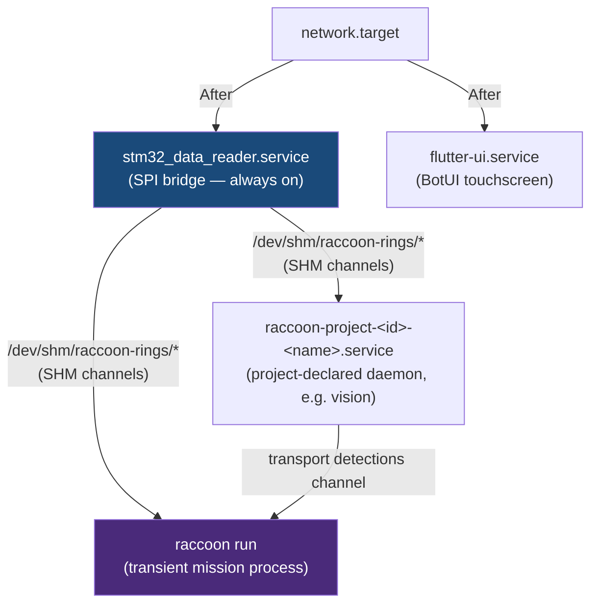
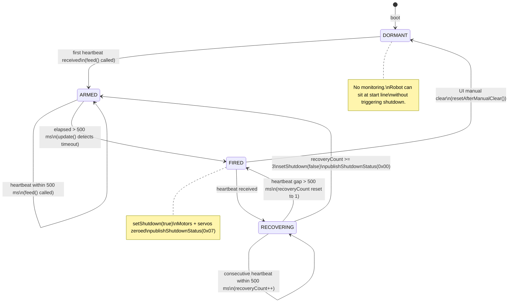
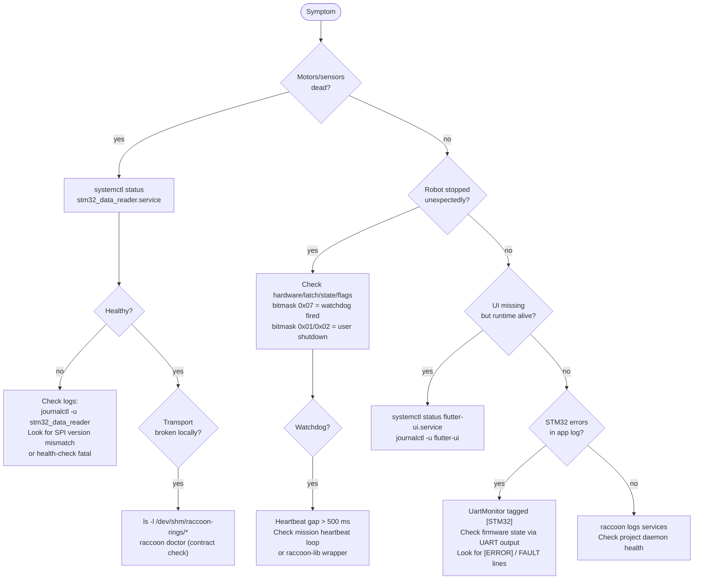

# Robot Services And systemd

## Mental model: what is actually running on the robot

The robot is not just "your Python program." Several long-lived processes and systemd units exist underneath it. Understanding their topology is essential when debugging startup, sensor failures, or unexpected motor stops.

The service layer has three tiers. Platform services (always on, independent of project) sit at the bottom. Project-owned services are deployed per-project by the toolchain. User code — the mission runner — is the transient top layer.



**Key insight:** `stm32_data_reader` is always-on infrastructure, not part of user code. It holds the SPI connection to the STM32, publishes all sensor data, and runs the MotorWatchdog and UartMonitor internally. If it is not healthy, hardware is dead. Many "robot is alive but motors/sensors are dead" failures reduce to this single unit.

Sources of truth in the repository:

- `stm32-data-reader/systemd/stm32_data_reader.service`
- `botui/systemd/flutter-ui.service`
- `stm32-data-reader/src/wombat/Application.cpp`
- `stm32-data-reader/include/wombat/services/MotorWatchdog.h`
- `stm32-data-reader/include/wombat/services/SystemMonitor.h`
- `stm32-data-reader/include/wombat/services/UartMonitor.h`
- `stm32-data-reader/firmware/Firmware/src/Storage/flash_cal.c`
- `stm32-data-reader/firmware/Firmware/include/Storage/flash_cal.h`

---

## `stm32_data_reader.service`

### What it is

This is the Pi-side bridge process. It owns the SPI connection to the STM32 and is the single publisher of all hardware state to the transport. Every Python mission process, the BotUI, and all project daemons consume data it puts on `/dev/shm/raccoon-rings/*` files.

### Unit characteristics

| Property | Value |
|---|---|
| `User` / `Group` | `pi` / `pi` |
| `WorkingDirectory` | `/var/lib/stm32-data-reader` (the packaged unit; the source unit in the repo says `/home/pi/stm32_data_reader`) |
| `ExecStart` | `/usr/bin/stm32_data_reader` |
| `Restart` | `always` |
| `RestartSec` | `5` (seconds) |
| `RestartPreventExitStatus` | `78` (the reader refused to start because of the [transport contract check](); restarting cannot fix that) |
| `NoNewPrivileges` | `true` |
| `PrivateTmp` | `false` (explicit — see below) |
| `ProtectSystem` | not set |
| `ProtectHome` | not set |

### The raccoon_ring SHM constraint: why `PrivateTmp=false` is mandatory

`raccoon::Transport` creates one `/dev/shm/raccoon-rings/<channel>` file per transport channel. All inter-process communication on the robot goes through these shared-memory ring files: the reader writes, the BotUI and Python mission read.

Any systemd sandboxing directive that builds a private mount namespace — including `PrivateTmp=true`, `ProtectSystem=`, or `ProtectHome=` — causes systemd to create an `MS_SLAVE` bind mount over `/dev/shm` for the service. The ring files the reader creates under that namespace are then invisible to every other process on the host. From the perspective of a Python mission, the `/dev/shm` directory is empty and `raccoon_transport` channel subscriptions time out waiting for IMU heading, BEMF, and battery data.

The unit does not wipe the files in `/dev/shm/raccoon-rings/` before a restart: a restarted reader attaches to the existing rings, so subscribers keep running. A subscriber that waits notices a ring file that was deleted and created again within about a second.

> **Do not add `PrivateTmp=true`, `ProtectSystem=`, or `ProtectHome=` to this unit.**
>
> This was verified on 2026-06-02: dropping `ProtectSystem+ProtectHome` turned a 100 % probe-fail rate to a working Pi within 0.1 s.

### STM32 health check (the authoritative liveness signal)

The reader checks `txBuffer.updateTime` on every main loop tick (`Application::checkStm32Health()`). If this timestamp has not changed for more than **10 seconds**, the reader logs a fatal error and sets `shouldShutdown_ = true`, which exits the main loop and causes systemd to restart it after the 5 s delay.

```
STM32 health check failed: updateTime has not changed for >10s — shutting down
```

This is the primary liveness signal. The UART heartbeat is secondary and warn-only (see UartMonitor section).

### Transport contract check (before everything else)

`main()` runs the transport contract check **before** the startup sequence below. It compares the reader's compiled-in contract hash and its own version with `/etc/raccoon-bundle.json` and writes the result to `/run/raccoon/stm32-data-reader.json` (persistent). On `mismatch`, `version-mismatch` or `bundle-fehler` it logs the reason to the journal and exits with code **78**; `RestartPreventExitStatus=78` keeps systemd from restarting it in a loop. `raccoon doctor` then shows the reader as `not active` with its result, and the Pi server refuses runs. Off a Raccoon device (no `/etc/raccoon-image`) the check is skipped, and in dev mode it only warns. `--version` is not affected.

```bash
journalctl -u stm32_data_reader -n 20      # the reason, with both sides' hashes and versions
cat /run/raccoon/stm32-data-reader.json    # the recorded result
```

Because the reader is the single publisher of all hardware state, a refused reader means no sensor data at all. That is intended: a reader built against another transport would publish messages nobody decodes. Fix with `raccoon update` or by flashing the latest image, then `sudo systemctl restart stm32_data_reader`.

### Startup sequence

The reader starts the UART monitor before it resets the STM32 so the boot output is captured, then opens SPI, probes `TRANSFER_VERSION` (21; a mismatch triggers a firmware reflash) and subscribes to the command channels. The steps are listed in [Pi Bridge Internals](), the version probe and reflash in [Build and Flash]().

### Runtime log level override

```bash
# One-shot override in the shell:
WOMBAT_LOG_LEVEL=debug /usr/bin/stm32_data_reader

# Persistent override via drop-in:
# /etc/systemd/system/stm32_data_reader.service.d/override.conf
[Service]
Environment=WOMBAT_LOG_LEVEL=debug
```

Valid values: `debug`, `info`, `warn` (or `warning`), `error` (or `err`). Reload and restart after editing the drop-in:

```bash
sudo systemctl daemon-reload && sudo systemctl restart stm32_data_reader.service
```

---

## MotorWatchdog (Pi-side hardware safety)

### Why it exists

Without a watchdog, a crashed or hung Python process leaves motors running at their last commanded speed indefinitely. The MotorWatchdog provides an automatic hardware kill that does not depend on the user program cleaning up correctly. It runs inside `stm32_data_reader`, not in user code, so it cannot be accidentally omitted or disabled by a mission programmer.

### Architecture

`MotorWatchdog` is a member of `Application` (not a separate thread or process). Its `update()` method is called on every main loop tick. `CommandSubscriber` calls `feed()` whenever it receives a heartbeat message on `hardware/watchdog/cmd/heartbeat`.

```
Python mission (raccoon-lib)
  └─ publishes heartbeat_cmd every ~100 ms
       └─ CommandSubscriber::onHeartbeat()
            └─ MotorWatchdog::feed()

Application main loop (every tick)
  └─ MotorWatchdog::update(controller, publisher)
       ├─ if elapsed > 500 ms → fire: setShutdown(true)
       └─ if 3 consecutive feeds within 500 ms → clear: setShutdown(false)
```

### State machine



### Configuration (source-verified)

| Parameter | Default | Description |
|---|---|---|
| `timeout_` | `500 ms` | Maximum allowed gap between heartbeats |
| `recoverFeeds_` | `3` | Consecutive on-time heartbeats required to clear shutdown |

Both are constructor parameters of `MotorWatchdog(Duration timeout, int recoverFeeds)`. They are not runtime-configurable — changing them requires a recompile.

### What "fired" means at the hardware level

When `fired_` transitions from `false` to `true`, `update()` calls:

1. `DeviceController::setShutdown(true)` — this in turn:
   - Sets all four `motorStates_[port]` to `MotorState{}` (zeroed) and pushes them to the SPI buffer
   - Writes `rxBuffer.systemShutdown = SHUTDOWN_MOTOR` via SPI
2. `DataPublisher::publishShutdownStatus(0x06)` — publishes the bitmask to `hardware/latch/state/flags`

### SHUTDOWN_STATUS bitmask

| Bit | Mask | Meaning |
|---|---|---|
| 0 | `0x01` | Reserved, never set |
| 1 | `0x02` | Motor shutdown active |
| 2 | `0x04` | Source = watchdog (vs. a user-initiated command on `hardware/latch/cmd/engaged`) |

`0x06` = motor latch plus watchdog source = watchdog fired. `0x02` = user-initiated latch. `0x00` = shutdown cleared.

The BotUI subscribes to `hardware/latch/state/flags` and displays the shutdown reason so operators can distinguish a watchdog stop from a deliberate stop command.

### Sending heartbeats from Python

Python missions using `raccoon run` get heartbeating automatically via raccoon-lib. If you are driving the transport layer directly:

```python
from raccoon_transport import Transport
from raccoon_transport.channels import Channels
from raccoon_transport.types.raccoon import scalar_i32_t
import time

transport = Transport()
hb = scalar_i32_t()
hb.value = 1

while mission_running:
    transport.publish(Channels.HEARTBEAT_CMD, hb)
    # ... mission work ...
    time.sleep(0.1)  # 100 ms cadence; watchdog fires at 500 ms
```

### Manual watchdog clear

The BotUI calls `MotorWatchdog::resetAfterManualClear()` when the operator acknowledges the shutdown. This sets `fired_ = false`, `recoveryCount_ = 0`, and also sets `armed_ = false` — returning the watchdog to the dormant state. It will re-arm automatically on the next heartbeat from the next mission run.

---

## SystemMonitor (Pi CPU temperature)

### What it does

`SystemMonitor` reads the Raspberry Pi's CPU temperature from the Linux thermal subsystem and publishes it to the `system/state/cpu_temperature` transport channel. It does not monitor RAM, load average, or any other metric — only CPU temperature.

### Implementation

`SystemMonitor::updateCpuTemperature()` is called on every main loop tick with a `publishInterval` argument of `1000 ms`. The method rate-limits itself using `lastCpuTempPublishTime_` and only reads the sensor when the interval has elapsed.

Temperature is read from `/sys/class/thermal/thermal_zone0/temp`, which returns an integer in millidegrees Celsius (e.g., `52000` = 52.0 °C). The monitor divides by 1000 and validates the range `[-40.0, +125.0]` °C before publishing. Values outside that range are treated as read errors.

```
/sys/class/thermal/thermal_zone0/temp
   → raw integer (millidegrees)
   ÷ 1000
   → float °C
   → broker_->publish(Channels::CPU_TEMPERATURE, scalar_f_t{temp})
```

### Failure handling

If the thermal file cannot be opened or the value is out of range, `updateCpuTemperature()` returns a `Result::failure`. The Application logs the failure at `debug` level and continues — a missing thermal sensor is not fatal.

### Subscribing to CPU temperature

```python
from raccoon_transport import Transport
from raccoon_transport.channels import Channels
from raccoon_transport.types.raccoon import scalar_f_t

transport = Transport()

def on_cpu_temp(channel, data):
    msg = scalar_f_t.decode(data)
    print(f"Pi CPU: {msg.value:.1f} °C")

transport.subscribe(Channels.CPU_TEMPERATURE, on_cpu_temp)
```

The channel name is `system/state/cpu_temperature` (from `raccoon::Channels::CPU_TEMPERATURE`).

---

## UartMonitor (STM32 debug output forwarding)

### What it is

`UartMonitor` opens `/dev/ttyAMA0` in read-only, non-blocking raw mode and tails the STM32's UART3 debug output during the main loop. Every line the STM32 prints becomes a Pi-side log entry tagged `[STM32]`. Error lines additionally reach the `messages/error` transport channel as a message with the title "STM32 reader" (via the logger), which means STM32 faults appear as an error dialog in BotUI without any extra tooling.

### Initialization details

The monitor opens the device with `O_RDONLY | O_NOCTTY | O_NONBLOCK`, configures it for **8N1** at **115200 baud** using termios raw mode (`cfmakeraw`), sets `VMIN=0 / VTIME=0` (non-blocking), and flushes stale data with `tcflush(TCIFLUSH)` before use.

Internal buffers:
- `READ_BUFFER_SIZE = 256` bytes per `read()` call
- `MAX_LINE_BUFFER = 4096` bytes line accumulator (cleared on overflow with a warning)

If the device cannot be opened, the monitor logs a warning and sets `isOpen_ = false`. All subsequent `processUpdate()` calls return immediately — the service degrades gracefully.

### Log level routing

```cpp
// UartMonitor::processLine() — exact logic from source
if (line contains "[ERROR]" or "Error" or "FAULT")
    logger_->error("[STM32] " + line);   // → messages/error channel
else if (line contains "[WARN]")
    logger_->warn("[STM32] " + line);
else
    logger_->info("[STM32] " + line);    // includes heartbeat lines
```

This is a substring scan, not a prefix check. A line containing `Error` anywhere (e.g., `Invensense Error code 5`) triggers the error path.

### STM32 UART heartbeat — warn-only

The STM32 firmware prints a `[stp] hb #N` marker every **5 seconds** (`HEARTBEAT_INTERVAL 5000` ms, `main.c:44`). The `UartMonitor` records the timestamp of each heartbeat via `noteLoopTime()`.

The heartbeat check (`Application::checkStm32Heartbeat()`) emits a warning if no heartbeat has been seen for more than **12 seconds**, and re-warns at most every **30 seconds**. It **never terminates the reader**. This is intentional:

> The STM32 goes silent on UART for extended periods when `cal_save_to_flash()` is called from `main.c`. Even though the function is currently a no-op, the comment in `Application.cpp` records that the original implementation blocked UART TX interrupts for over 12 seconds per flash write. During that window, SPI/DMA transfers continued normally. Killing the reader for a silent UART during a flash write would cascade into a probe-fail in the Python mission program even though all sensors are live.

The authoritative liveness signal is `txBuffer.updateTime` checked by `checkStm32Health()`. The UART heartbeat is a diagnostic indicator only.

### What appears in the STM32 heartbeat line

```
[stp] hb #42 t=210s conv=5829 st=2 bemfMot=3 adc=[1024,987]
      modes=[3,3,0,0] pos=[1200,−830,0,0] bemf=[12,−8,0,0]
```

Fields (from `main.c`):
- `#N` — heartbeat counter
- `t=Xs` — STM32 uptime in seconds (`HAL_GetTick() / 1000`)
- `conv=N` — BEMF ADC conversion count
- `st=N` — BEMF state machine state
- `bemfMot=N` — which motor is currently being measured
- `adc=[a,b]` — raw ADC readings for BEMF channels 0 and 1
- `modes=[m0,m1,m2,m3]` — motor control mode (0=OFF, 1=PASSIVE_BRAKE, 2=PWM, 3=MAV, 4=MTP, 5=CHASSIS)
- `pos=[p0..p3]` — motor position in BEMF ticks
- `bemf=[b0..b3]` — filtered BEMF readings

### Configuration

| Field | Default | Description |
|---|---|---|
| `uart.devicePath` | `/dev/ttyAMA0` | Serial device node |
| `uart.baudRate` | `115200` | Baud rate (must match STM32 UART3) |
| `uart.enabled` | `true` | Whether to open the device |

Setting `uart.enabled = false` in the reader configuration skips `UartMonitor` construction entirely. The `drainFor()` branch in startup also falls back to a plain `sleep_for(2000 ms)` when the monitor is absent.

---

## IMU calibration is not persisted

The STM32 does not store the IMU calibration across boots. `cal_save_to_flash()`, `cal_load_from_flash()` and `cal_has_saved_data()` in `flash_cal.c` are deliberate no-ops, so every boot starts the IMU without stored biases. The MPL runs `inv_enable_in_use_auto_calibration()` and `inv_enable_fast_nomot()` and converges to usable gyroscope, accelerometer and compass biases within two to three minutes of normal motion. The robot re-calibrates in `M000SetupMission` anyway, so a cold start is not a problem.

The save path stays disabled because a polling-mode flash erase blocks the main loop for minutes. During that time the UART goes silent and servo commands are not applied, because the PWM update runs in the main loop. The Pi-side `checkStm32Heartbeat()` logs a warning when the heartbeat stops for 12 s.

The Pi can still set `PI_BUFFER_UPDATE_SAVE_IMU_CAL (0x08)` in `rxBuffer.updates`. The firmware accepts the flag, calls `cal_save_to_flash()` and does nothing else. If you re-enable flash persistence, use the interrupt-mode variants (`HAL_FLASH_Program_IT`, `HAL_FLASHEx_Erase_IT`) from a low-priority background task, with SysTick and the PWM update timers at a higher NVIC priority than the flash interrupt.

---

## `flutter-ui.service`

The BotUI touchscreen frontend runs as a dedicated service separate from the reader.

| Property | Value |
|---|---|
| `ExecStart` | `flutter-pi -r 0 --videomode 800x480 --release /home/pi/stp-velox/` |
| `WorkingDirectory` | `/home/pi` |
| `User` / `Group` | `pi` / `pi` |
| `Restart` | `always` |
| `RestartSec` | `2` |
| `StandardOutput/Error` | `journal` |

The 2 s restart delay is intentionally short: the BotUI contains a `FrameStallWatchdog` that self-exits when the render pipeline wedges. A fast restart recovers the UI within seconds.

A dead UI does **not** imply a dead robot runtime. The `stm32_data_reader` and the mission process are completely independent of `flutter-ui.service`. If the UI is gone but the robot should be running, check the reader and the mission process first.

---

## Project-owned services

Projects can declare long-lived daemons in `raccoon.project.yml`. These are deployed by the toolchain as `raccoon-project-<project-id>-<service>.service` units. See the complete example from the drumbot vision daemon:

```yaml
vision:
  module: src.daemons.vision
  restart: always
  restart_sec: 1
  after_sync: restart_if_changed
  required_for_run: true
  watch:
    - src/daemons/vision.py
    - src/hardware/usb_camera.py
    - src/service/color_detection_service.py
```

The canonical use case: the daemon owns `/dev/video0`. The mission is a thin subscriber. Restarting the mission does not tear down the camera and does not pay the multi-second warm-up cost of reopening the device.

### `after_sync` values

| Value | Effect |
|---|---|
| `restart` | Always restart after sync |
| `restart_if_changed` | Restart only if rendered unit or watched files changed |
| `leave_running` | Do not restart automatically after sync |

### `required_for_run`

When `true`, the toolchain checks service health before allowing `raccoon run`. If the daemon has crashed, the run is aborted with an error. Treat `required_for_run` failures as hard preconditions — the daemon is not optional.

### CLI visibility

```bash
raccoon logs services
raccoon logs services show <service-name>
```

Fields in the output: active state, sub-state, main PID, restart count, activation timestamp, whether the service is `required_for_run`.

### Transport from project daemons

Use `get_transport()` from the `raccoon` package, not `raccoon_transport.Transport()` directly. Constructing a separate `Transport` creates duplicate subscriptions and ring-file conflicts.

```python
from raccoon import RobotService, get_transport

class VisionService(RobotService):
    def start(self):
        self._transport = get_transport()
        self._transport.subscribe("camera/state/detections", self._on_detections)
```

---

## Practical debugging workflow



| Symptom | First check |
|---|---|
| Motors or sensors dead | `systemctl status stm32_data_reader.service` |
| Transport dead locally | `ls /dev/shm/raccoon-rings/*` (ring files present?), then `systemctl status stm32_data_reader.service` |
| Robot stopped unexpectedly mid-run | `hardware/latch/state/flags` — bitmask `0x07` means watchdog |
| UI missing but hardware alive | `systemctl status flutter-ui.service` |
| STM32 errors in application log | UartMonitor forwarded them — check firmware state |
| Project daemon broken | `raccoon logs services show <service-name>` |
| UART heartbeat warnings in log | Not fatal — likely flash-write stall; verify SPI is still live |

---

## Why this architecture is shaped this way

- **Hard realtime stays on the STM32.** The Pi is general-purpose Linux; it cannot give timing guarantees to PWM signals or encoder reads.
- **The SPI bridge is always-on infrastructure.** It restarts automatically, maintains the SHM ring files so subscribers never lose their channel connections, and publishes safety status even when no mission is running.
- **Safety (MotorWatchdog) is baked into the bridge, not user code.** A mission programmer cannot forget to wire in the watchdog — it runs unconditionally in `stm32_data_reader`.
- **Debug output (UartMonitor) is forwarded automatically.** Operators never need a serial terminal for routine operation. STM32 faults appear in the same log and UI error feed as Pi-side errors.
- **Project daemons are first-class systemd units.** They survive mission restarts, own their hardware resources, and are health-checked before a mission can run.

That separation makes the platform debuggable: a robot can fail partially and be diagnosed by layer, rather than failing as one opaque process.

---

## Related pages

- [Pi Bridge Internals](/06-advanced/04-firmware/pi-bridge-internals/) — deep dive into `Application` lifecycle, `MotorWatchdog` state machine, `raccoon_ring` SHM transport, and `PrivateTmp` constraints
- [Data Pipeline](/06-advanced/04-firmware/data-pipeline/) — how `stm32_data_reader.service` fits into the full sensor data path
- [Build and Flash](/06-advanced/04-firmware/build-flash/) — how to build and deploy the `stm32-data-reader` binary
- [Architecture Overview](/06-advanced/04-firmware/architecture/) — the full responsibility split between STM32 and Pi
