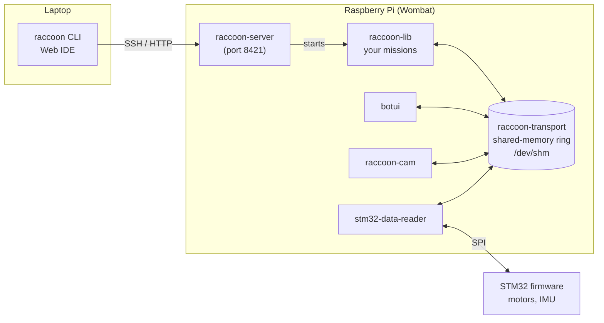

# Advanced

You do not need this section to program a robot. It documents **how RaccoonOS is built**: which components exist, how they talk to each other, and how the firmware, the transport and the Web IDE work inside. Read it when you debug something deep, extend the platform, or are just curious.

## The platform at a glance

| Component | What it is | Repository |
|-----------|-----------|------------|
| **raccoon-lib** | The C++20 library with Python bindings: steps, missions, motion control, odometry. Your mission code runs on it | `raccoon-lib` |
| **STM32 firmware** | Runs on the STM32 microcontroller: motor control, IMU, and the chassis velocity loop | `stm32-data-reader` (`firmware/`) |
| **stm32-data-reader** | Service on the Pi that talks SPI to the STM32 and publishes its data on the transport | `stm32-data-reader` |
| **raccoon-transport** | Messages, channels and the shared-memory transport between all components, for C++, Python and Dart, plus the contract hash | `raccoon-transport` |
| **botui** | The touchscreen UI on the robot (Flutter, rendered with flutter-pi) | `botui` |
| **raccoon-cli / raccoon-server** | The laptop tool and the daemon on the Pi that receives files and starts programs. The Web IDE is part of it | `raccoon-cli` |
| **raccoon-cam** | Camera service with pluggable image processors | `raccoon-cam` |
| **raccoon-image** | Builds the RaccoonOS SD card image from a bundle of component releases | `raccoon-image` |

Every component is built and released on its own. A **bundle** names the exact version of each, and the transport **contract hash** makes sure they all speak the same wire format. See [Releases]().

## In this section

| Page | What it covers |
|------|----------------|
| [Library Architecture]() | The layers of `raccoon-lib`, the module map and what happens when you call `drive_forward(25)` |
| [Transport]() | Channels, messages, the shared-memory ring and the contract check |
| [Firmware and Pi Bridge]() | STM32 firmware, SPI protocol, motor control, sensor pipeline, the Pi bridge |
| [Web IDE Internals]() | How the Web IDE backend and frontend are built |

Looking for how to build or release these components yourself? That is in [Build and Contribute]().
